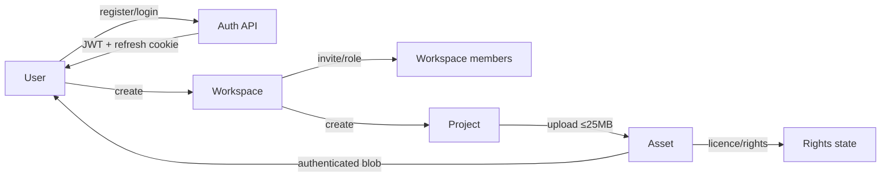
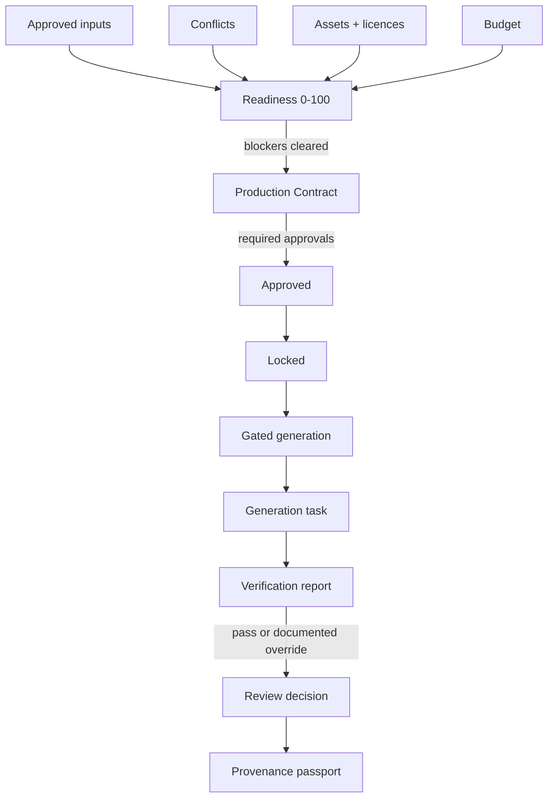
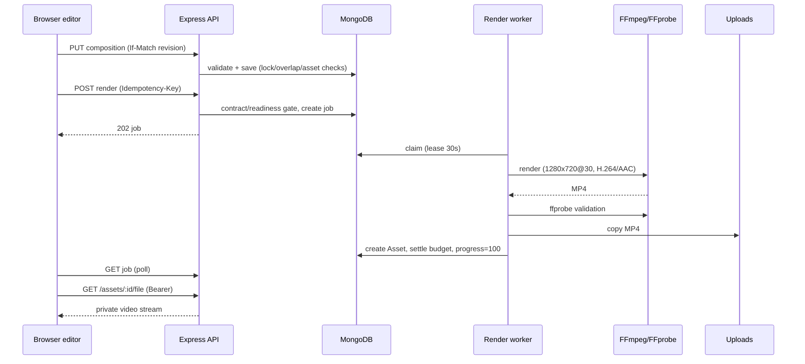
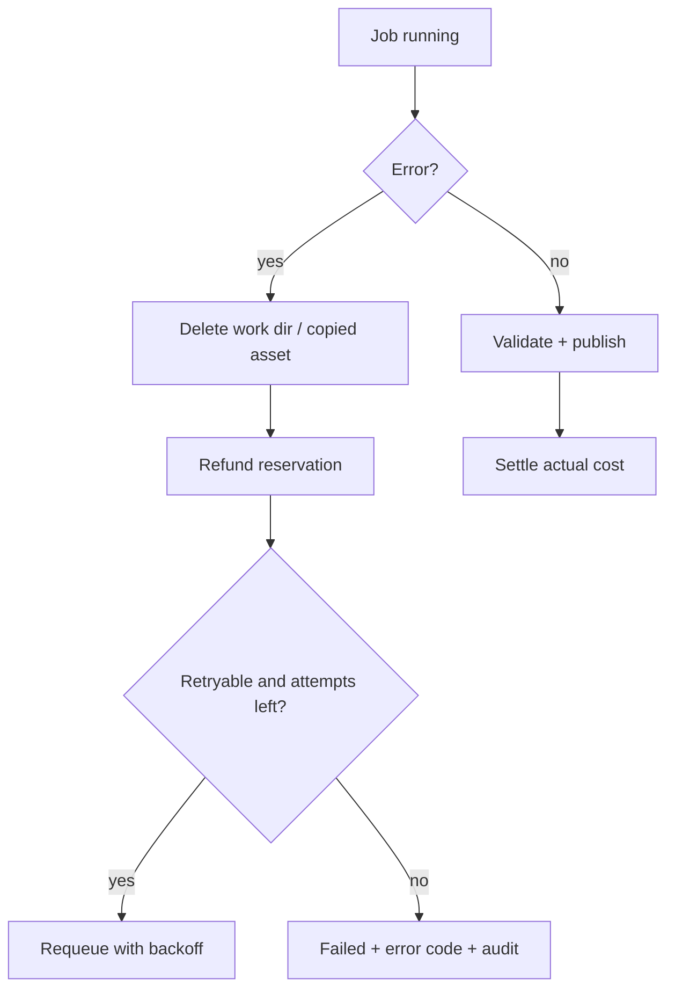

# ReadyForge — Complete Product Feature Inventory

**Analysis date:** 2026-10-30
**Scope:** the repository at its current working-tree state (branch `main`, 14 uncommitted Phase 3B/3C files preserved, nothing reset/stashed/committed).
**Method:** source inspection of every router, model, engine, service, page and test file; live test execution; live FFmpeg/FFprobe capability and artifact probing; recorded acceptance runs already in the repository. This was an analysis-only pass: no application code, configuration, dependencies, database or Git state were changed. The only file written is this report.

### Status vocabulary (exactly one per feature)

| Status | Meaning |
|---|---|
| **FULLY IMPLEMENTED** | Code exists and the complete workflow has execution evidence (automated acceptance or a recorded/reproduced run). |
| **PARTIALLY IMPLEMENTED** | Some of the workflow exists; named parts are missing or behave with a known limitation. |
| **FRONTEND ONLY** | UI exists but the backend capability is absent or not connected. |
| **BACKEND ONLY** | Server capability exists with no dedicated user-facing surface. |
| **IMPLEMENTED BUT UNVERIFIED** | Code appears complete but no execution evidence was available. |
| **NOT IMPLEMENTED** | No implementation found. |
| **BLOCKED** | Implementation exists but an external dependency/configuration prevents operation. |

### Evidence legend

| Code | Evidence |
|---|---|
| **T1** | Re-executed during this analysis: `npm run test:server` → **22 files / 211 tests passed**; `npm test` → **6 files / 29 tests passed** (2026-10-30 19:04–19:05). |
| **S1** | `scripts/smoke.mjs` acceptance suite, recorded **199/199 passed** in `docs/IMPLEMENTATION_STATUS.md` (2026-10-28). Not re-run in this read-only pass. |
| **V1** | Real Chromium browser walk-through in Phase 3A (login → workspace → project → editor → asset library → preview → save → capability status → render → protected output). |
| **V2** | Phase 3C genuine end-to-end runs: real API/worker/FFmpeg renders, extracted-frame and audio-level inspection, plus browser editing of animations/transitions/audio. |
| **P1** | Fresh FFprobe measurement of the Phase 3C artifacts performed during this analysis. |
| **C1** | Direct source inspection only (no runtime evidence). |

---

## 1. Executive Product Overview

ReadyForge is an **AI production-readiness operating system for content campaigns**, with an integrated **multi-track video editor and local renderer**. It is aimed at solo creators and small teams who use generative AI and want to settle intent, facts, conflicts, rights, brand rules and budget *before* spending on generation — then produce, verify, review, and trace the output.

The product currently does two things genuinely:

1. **Governance chain (broad and exercised).** Workspace → project → role-based knowledge inputs → conflict detection/resolution → rights and licence checks → readiness scoring, risk and cost-at-risk → versioned Production Contract with stage approvals and a lock → gated generation (script/storyboard/documents) → verification report → review → provenance passport with JSON/PDF export.
2. **Real local video production (narrow but genuine).** A multi-track timeline (video, audio, text) with trims, splits, transitions, text/title animations, SRT import, audio fades and volume, saved as a versioned composition and rendered by a real background worker using the project-local FFmpeg build — producing a validated H.264/AAC MP4 that is stored as a protected asset and played back through the application.

The free/local path is the default: video generation is local FFmpeg, AI is a self-hosted FastAPI service with a deterministic rule-engine fallback, and storage is local disk plus MongoDB. A paid Runway adapter and an optional OpenAI-compatible LLM client exist but are **not required** for any verified capability.

**What it cannot do today:** image/overlay tracks or image compositing, drag a clip across tracks, reorder/rename tracks in the UI, keyboard shortcuts in the editor, browser audio playback, configurable render resolution/frame-rate, AI-generated *video* without a paid provider, email delivery, workspace-level spend caps, session revocation/MFA, or production-scale job queueing. Details in §15–§16.

---

## 2. Technology Stack

| Layer | Technology / version | Notes |
|---|---|---|
| Monorepo | npm workspaces (`client`, `server`) | Root scripts: `dev`, `build`, `seed`, `typecheck`, `lint`, `test`, `test:server`, `verify`. |
| Frontend | React 19, Vite 6, TypeScript, React Router 7, TanStack Query, Zustand, react-hook-form + Zod, Tailwind CSS, lucide-react | 36 pages, 9 shared components; lazy-loaded authenticated routes. |
| Backend | Node.js 20+, Express 4, TypeScript (CommonJS), Zod, Mongoose 8, JWT, bcryptjs, multer, helmet, express-rate-limit | 17 routers, **151 HTTP handlers**. |
| Database | MongoDB (external URI or `mongodb-memory-server` file-backed fallback in `server/.data/mongo`) | 21 Mongoose models. |
| AI (default) | Self-hosted FastAPI `ai-service/` on `:8001`: Qwen2.5-0.5B-Instruct for generation via OpenAI-compatible `/v1/chat/completions`, fine-tuned DistilBERT-MNLI for contradictions | Keyless. On failure the backend falls back to a deterministic rule engine and labels the source honestly. |
| AI (optional) | Any OpenAI-compatible endpoint (`OPENAI_*`), Runway video provider (`RUNWAY_API_KEY`, paid) | Not required by the verified workflows. |
| Video | Project-local FFmpeg/FFprobe in `tools/ffmpeg/bin` (`FFMPEG_PATH`, `FFPROBE_PATH`) | **ffmpeg/ffprobe version N-128198-g37515cfd87-20261029**; libx264 and native AAC present; MP4 muxer present (measured today). |
| Rendering | `libx264` (H.264), AAC 192 kbit/s, 48 kHz stereo, MP4 `+faststart`, fixed 1280×720 @ 30 fps | Filter graph: trim/scale/pad, overlay compositing, `blend`/`alphamerge` transitions, `drawtext` with staged text/font files, `zoompan` title layer, `amix`+`alimiter`. |
| Tests | Vitest (server + client), `scripts/smoke.mjs` API journey, `scripts/verify-render.ts`, UI verification scripts | 211 server + 29 client tests re-run today. |
| Storage | Local uploads directory (`server/uploads`), rendered copies registered as `Asset` rows, authenticated streaming route | Outputs capped at 250 MB; render temp dirs removed on completion/failure. |

---

## 3. Complete Module Inventory

| Module | Responsibility | Primary code |
|---|---|---|
| Authentication & identity | Register/login/refresh/logout, password reset, email verification tokens, profile/preferences, data export, account deletion | `routes/auth.ts`, `middleware/auth.ts`, `models/User.ts`, `crypto.ts`, `email.ts` |
| Workspaces & membership | Workspace CRUD, archive/restore, 10 roles, member management, brand DNA/settings, audit feed | `routes/workspaces.ts`, `routes/invitations.ts`, `models/Workspace.ts`, `services/invitations.ts`, `services/ownership.ts` |
| Invitations & ownership transfer | Hashed single-use invite tokens, resend/cancel/accept/reject/expiry, owner transfer with optimistic concurrency | `services/invitations.ts`, `services/ownership.ts`, `models/WorkspaceInvitation.ts` |
| Projects | Campaign CRUD, status machine, members/roles, templates, activity, readiness/cost/contract endpoints | `routes/projects.ts`, `models/Project.ts`, `models/ProjectMember.ts` |
| Knowledge inputs & ledger | Role-based questions, input CRUD, approve/dispute, version history, AI question generation | `routes/inputs.ts`, `models/KnowledgeInput.ts`, `ai/questions.ts` |
| Conflict resolution | Detection (AI + NLI + rules), recommendations, assignment, resolve/dismiss, consensus visibility | `routes/conflicts.ts`, `ai/conflicts.ts`, `models/Conflict.ts` |
| Assets & rights | Upload, probe duration, metadata, licence states, rights verification, protected file streaming, output registration | `routes/assets.ts`, `models/Asset.ts`, `services/videoOutput.ts` |
| Readiness & risk | 7 weighted readiness categories and blockers, campaign risk score, cost-at-risk + waste receipt | `engines/readiness.ts`, `engines/riskScore.ts`, `engines/costAtRisk.ts` |
| Budget | Atomic project budget charge/refund, reservations, settlement, idempotent operations, recovery | `services/budget.ts`, `services/videoBudget.ts`, `models/BudgetReservation.ts` |
| Production Contract | AI-drafted, versioned contract; stage approvals; reject; lock; diff; generation gate | `routes/projects.ts`, `engines/contract.ts`, `models/ProductionContract.ts` |
| Draft ladder & generation | 5-stage ladder, stage gating, script/storyboard/document generation, task review/regeneration, AI usage logs | `routes/generation.ts`, `ai/generation.ts`, `models/GenerationTask.ts`, `models/AiUsageLog.ts` |
| Verification & review | Claim/scene verification, severity/evidence/suggested fixes, human override, review decisions | `ai/verify.ts`, `routes/generation.ts`, `models/VerificationReport.ts`, `models/Review.ts` |
| Provenance | Provenance passport, JSON and dependency-free PDF export, decision replay, autopsy | `routes/generation.ts`, `routes/intelligence.ts` |
| Taste & intelligence | Taste profile/overrides, variants, audience simulation, forecasts, brand drift, knowledge decay, rights sentinel, model trust/bargain, decision debt, failure patterns | `routes/taste.ts`, `routes/intelligence.ts`, `engines/*` |
| Analytics & admin | Workspace/project/AI-usage analytics, admin stats | `routes/analytics.ts`, `routes/admin.ts` |
| Notifications & comments | Persistent notifications, unread/read-all, comment threads with @mentions | `routes/notifications.ts`, `routes/comments.ts` |
| Video editor | Multi-track timeline, drag/trim/split/duplicate, inspector, text animations, transitions, audio shaping, SRT import, save/undo/redo, preview, render submission | `client/src/pages/VideoEditor.tsx`, `routes/compositions.ts`, `models/EditComposition.ts` |
| Render pipeline & worker | Composition validation, FFmpeg filter-graph build, job queue/lease/retry/idempotency, validation, asset publication, protected playback | `services/compositionRenderer.ts`, `services/videoJobs.ts`, `services/ffmpegTools.ts`, `services/videoOutput.ts` |
| AI service | Local model host (chat + NLI endpoints), training/eval artifacts | `ai-service/app/main.py`, `ai-service/models/nli-distilbert` |

---

## 4. Detailed Feature and Subfeature Matrix

### A. Authentication and user management

| Feature | Subfeature | Status | Evidence |
|---|---|---|---|
| Registration | Email + password (bcrypt cost 10), name, duplicate → 409 | FULLY IMPLEMENTED | `routes/auth.ts`, `auth.test.ts`, S1 |
| Login | Generic 401 on bad credentials, access + refresh issuance | FULLY IMPLEMENTED | S1 (smoke B) |
| Session persistence | Client bootstraps `/auth/me`; access token refreshed on 401 | FULLY IMPLEMENTED | `client/src/lib/api.ts`, `store/auth.ts`, `client.test.ts` |
| Refresh rotation | `/auth/refresh` and `/auth/logout` rotate/clear the cookie | FULLY IMPLEMENTED | S1 |
| Logout | Refresh cookie cleared, token rotation | FULLY IMPLEMENTED | S1 |
| Password change | Current-password verification | FULLY IMPLEMENTED | S1 (smoke Q) |
| Forgot/reset password | SHA-256 single-use token, 30 min expiry, old password rejected after reset | FULLY IMPLEMENTED | S1 (smoke P), `crypto.ts` |
| Profile | Name, language, IANA timezone; validated | FULLY IMPLEMENTED | S1 (smoke Q), `ProfilePage` |
| Notification preferences | Per-type toggles honoured by server | FULLY IMPLEMENTED | `User.wantsNotification`, S1 |
| Data export | Profile, workspaces, inputs, reviews, notifications; no password material | FULLY IMPLEMENTED | S1 (smoke Q) |
| Account deletion | Password-confirmed, cascades workspaces/projects | FULLY IMPLEMENTED | S1 (smoke Y) |
| Email verification | Token issue/verify/resend endpoints + `VerifyEmailPage` exist; **no provider adapter**, so delivery always reports `delivered:false` and dev returns the link | BLOCKED | `email.ts`, `routes/auth.ts`, `IMPLEMENTATION_STATUS.md` §24 |
| Session list / revoke-all | No endpoint, no UI | NOT IMPLEMENTED | no route/model |
| Roles | 10 workspace roles + `platformRole: admin` | FULLY IMPLEMENTED | `models/Workspace.ts`, S1 |
| Protected routes | Server `requireAuth`, client `RequireAuth` redirect | FULLY IMPLEMENTED | `middleware/auth.ts`, `App.tsx`, T1 |

### B. Workspace management

| Feature | Subfeature | Status | Evidence |
|---|---|---|---|
| Create/edit/delete | Currency, AI provider settings, budget threshold, brand DNA | FULLY IMPLEMENTED | `routes/workspaces.ts`, S1 |
| Archive/restore | Non-destructive archive flag | FULLY IMPLEMENTED | S1 (smoke R) |
| Workspace switcher & settings UI | `WorkspaceDetail`, `SettingsPage` | FULLY IMPLEMENTED | S1/V1 |
| Members | List, invite, role change, remove | FULLY IMPLEMENTED | S1 |
| Invitations | Create/list/resend/cancel; hashed token; 7-day expiry; accept/reject; duplicate pending → 409; concurrent accept → one membership | FULLY IMPLEMENTED | `invitations.test.ts` (12), S1 |
| Ownership transfer | Offer/accept/cancel with optimistic concurrency; exactly one owner | FULLY IMPLEMENTED | `ownership.test.ts` (8), S1 |
| Last-owner protection | Owner cannot be removed/demoted | FULLY IMPLEMENTED | `routes/workspaces.ts` |
| Workspace isolation | Cross-tenant access → 403/404 | FULLY IMPLEMENTED | S1 (C/E/O), `auth.test.ts` |
| Audit log | Governance actions with actor/IP/before-after | FULLY IMPLEMENTED | `AuditLog`, S1 |
| Member activity history | No member-scoped activity view | NOT IMPLEMENTED | docs + route inspection |
| Workspace-level spend cap | Budget threshold is display-only; hard limits exist per project | NOT IMPLEMENTED | `IMPLEMENTATION_STATUS.md`, `budget.ts` |
| Brand DNA | Tone, banned words, palette, logo rules; used by readiness/brand scoring | FULLY IMPLEMENTED | S1 (C) |

### C. Project management

| Feature | Subfeature | Status | Evidence |
|---|---|---|---|
| Create project | Solo/team, type, brief, deadline, budget, template | FULLY IMPLEMENTED | S1 (smoke E) |
| Edit/status | 11 statuses, 5-stage ladder pointer | FULLY IMPLEMENTED | `models/Project.ts`, S1 |
| Delete project | Deletes inputs, conflicts, assets, contracts, members — **not** compositions, tasks, reports, reviews, comments, notifications, reservations, AI logs, or uploaded files | PARTIALLY IMPLEMENTED | `projects.ts:326-349` (C1) |
| Project dashboard | Readiness, stage, budget, activity | FULLY IMPLEMENTED | V1, S1 |
| Project members | Add member with project role + responsibilities | FULLY IMPLEMENTED | S1 (E) |
| Project access control | Workspace membership + role gates per route | FULLY IMPLEMENTED | `middleware/auth.ts`, S1 |
| Project templates | Built-in + workspace-saved + create-from-template | FULLY IMPLEMENTED | `templates.test.ts` (9), S1 |
| Validation endpoint | Required fields, stage readiness | FULLY IMPLEMENTED | S1 |
| Project archive | Only a status value; no archive action/UI | PARTIALLY IMPLEMENTED | `PROJECT_STATUSES` (C1) |
| Activity feed | `GET /projects/:id/activity` | FULLY IMPLEMENTED | route + `ProjectActivity` UI |

### D. AI production and content generation

| Feature | Subfeature | Status | Evidence |
|---|---|---|---|
| Local AI service | FastAPI: `/health`, `/v1/models`, `/v1/chat/completions`, `/nli/conflict`, `/nli/conflict_batch`, `/nli/verify`, `/nli/classify` | IMPLEMENTED BUT UNVERIFIED (current runtime) | `ai-service/app/main.py`; service is **down** on `:8001` now (HTTP 000); recorded run with it up exists (S1) |
| Local generation model | Qwen2.5-0.5B-Instruct, downloaded to HF cache on first call | IMPLEMENTED BUT UNVERIFIED | code paths; model not in repo |
| NLI contradiction model | Fine-tuned DistilBERT-MNLI, 1.0 GB artifact | IMPLEMENTED BUT UNVERIFIED | `metrics.json`: matched 0.766, mismatched 0.7698; recorded probe predicts `neutral` for the trial contradiction |
| Rule-engine fallback | Deterministic generation/conflict/verification when AI unavailable; labelled `rule_engine` | FULLY IMPLEMENTED | `ai/client.ts`, S1 (AI-down run 123/123) |
| Optional OpenAI-compatible LLM | Configurable base URL/model/key | IMPLEMENTED BUT UNVERIFIED | `ai/client.ts`, `config.ts` |
| Adaptive question generation | Required/optional, explanations | FULLY IMPLEMENTED | S1 (W-ai) |
| Project classification | Type/tone/audience inference | FULLY IMPLEMENTED | `ai/classify.ts`, S1 |
| Script / storyboard / outline | Ladder stages with persisted tasks, tokens, cost, model | FULLY IMPLEMENTED | S1 (K), `DraftLadder`, `ScriptEditor`, `StoryboardEditor` |
| Preview / final documents | Assembled documents with labelled simulation | FULLY IMPLEMENTED | `ai/generation.ts`, S1 |
| AI image generation | None | NOT IMPLEMENTED | — |
| AI video generation | Runway adapter (Gen-4.5) + polling; requires paid key; mock provider for pipeline tests | BLOCKED (without key) / IMPLEMENTED BUT UNVERIFIED | `runwayVideoProvider.ts`, `videoProviderFactory.ts`, `config.ts` |
| Task execution | Generation runs inside the HTTP request; no durable queue | PARTIALLY IMPLEMENTED | `ARCHITECTURE.md` §5 (C1) |
| Generation retry/cancel | Video jobs have retry/cancel; ladder generation does not | PARTIALLY IMPLEMENTED | `routes/generation.ts` |
| AI usage logging | Provider, model, tokens, cost, latency | FULLY IMPLEMENTED | `AiUsageLog`, S1 (O) |

### E. Production governance and readiness

| Feature | Subfeature | Status | Evidence |
|---|---|---|---|
| Readiness score | 7 weighted categories: completeness 25, consistency 20, factual 20, rights 15, brand 10, accessibility 5, budget 5 | FULLY IMPLEMENTED | `engines/readiness.ts`, `engines.test.ts` (21), S1 |
| Readiness blockers | Missing fields/evidence, no contract, unapproved contract, unapproved stage approvals, unresolved critical conflicts, unlicensed assets, no/tight budget | FULLY IMPLEMENTED | `readiness.ts`, `productionAuthorization.ts` |
| Category breakdown UI | `ReadinessDashboard` | FULLY IMPLEMENTED | V1/S1 |
| Production authorization | Pure evaluator used before generation **and** video render; revalidated inside worker against captured contract version | FULLY IMPLEMENTED | `services/productionAuthorization.ts`, `videoJobs.ts`, `projectAuthorization.test.ts` |
| Contract creation | AI/rule draft from project + inputs, version increments, supersede | FULLY IMPLEMENTED | S1 (J/S) |
| Contract approvals | Required approvers by role, approve/reject, stage-wise ladder gating | FULLY IMPLEMENTED | S1, `routes/projects.ts` |
| Contract lock | Locks further edits; generation requires approved/locked | FULLY IMPLEMENTED | S1 (10.16) |
| Contract diff/version history | Version list + diff | FULLY IMPLEMENTED | S1 (S) |
| Conflict detection | Direct, pricing, tone, brand, legal; AI/NLI/rules; severity | FULLY IMPLEMENTED | S1 (G), `ai/conflicts.ts` |
| Conflict resolution | Recommendation, accept, assign, resolve/dismiss, authority-aware | FULLY IMPLEMENTED | S1 (G) |
| Claim verification | Claims vs approved facts, statuses, evidence, suggested fixes | FULLY IMPLEMENTED | S1 (L/W) |
| Verification gate | Failed latest report blocks approval unless documented override | FULLY IMPLEMENTED | S1 (13.10/13.11) |
| Claim passport | Endpoint plus rendered claim list in the Provenance page | FULLY IMPLEMENTED | `GET /projects/:id/claim-passport`; `ProvenancePage.tsx:70,286` |
| Provenance passport | Contributor/claim/decision trace, JSON + dependency-free PDF | FULLY IMPLEMENTED | S1 (N), `ProvenancePage` |

### F. Cost and budget

| Feature | Subfeature | Status | Evidence |
|---|---|---|---|
| Project budget | Amount/currency/spent/remaining, editable | FULLY IMPLEMENTED | `models/Project.ts`, S1 |
| Atomic hard limit | Single conditional Mongo update; 6-way race test only 3 fit | FULLY IMPLEMENTED | `budget.test.ts` (10), `services/budget.ts` |
| Reservation | Pending → reserved, currency match, idempotent key | FULLY IMPLEMENTED | `videoBudget.test.ts` (7) |
| Settlement | Actual vs estimate delta charged/refunded; settled status | FULLY IMPLEMENTED | `videoBudget.ts` |
| Refund on failure | Reservation refunded; task failed | FULLY IMPLEMENTED | `videoJobs.test.ts` (30), S1 |
| Duplicate-charge prevention | `budget.appliedOperations.key` uniqueness + conditional update | FULLY IMPLEMENTED | `budget.ts`, tests |
| Crash recovery | Expired leases requeued; reconciliation of pending/settling/refunding reservations | FULLY IMPLEMENTED | `recoverVideoBudgetReservations`, `videoBudget.ts` |
| Cost-at-risk | Planned cost, rework probability, expected loss, signals, actions | FULLY IMPLEMENTED (with defect) | `costAtRisk.ts`; **planned cost indexed by project type, not stage**, so it collapses to the 300 fallback (see §16) |
| Waste receipt | If-render-now vs after-fixes, fixable items, verdict | FULLY IMPLEMENTED | `costAtRisk.ts`, `engines.test.ts` |
| Budget enforcement on render | Local render costs 0; reservation settled at 0 | FULLY IMPLEMENTED | `videoJobs.ts`, V2 |
| Workspace cap | Not enforced | NOT IMPLEMENTED | `ARCHITECTURE.md` §10 |

### G. Assets and rights

| Feature | Subfeature | Status | Evidence |
|---|---|---|---|
| Upload | 16 MIME types, 25 MB default, role-gated, filename sanitised | FULLY IMPLEMENTED | `assets.ts`, S1 (H) |
| Content sniffing | **MIME header allowlist only** for general assets; video/audio additionally FFprobe-validated | PARTIALLY IMPLEMENTED | `assets.ts` (C1) |
| Media duration probing | FFprobe duration stored, enables trimming | FULLY IMPLEMENTED | `probeMediaFile`, V1/V2 |
| Metadata update | Name, type, AI flag, consent | FULLY IMPLEMENTED | route + `AssetsLibrary` |
| Licence management | Status/type/owner/expiry/channels/regions/consent | FULLY IMPLEMENTED | S1 (H) |
| Rights verification | `/assets/:id/verify-rights` report; unlicensed assets block final | FULLY IMPLEMENTED | `RightsManager`, readiness, S1 |
| Protected delivery | `GET /assets/:id/file` requires active workspace membership; `private, no-store`; path-traversal guard | FULLY IMPLEMENTED | `assetAccess.test.ts` (2), V1/V2 |
| Delete | File + row removed (role-gated) | FULLY IMPLEMENTED | `assets.ts` |
| Thumbnails | Only image/logo reuse the original; no video poster generation | PARTIALLY IMPLEMENTED | `serialize()` C1 |
| Folders/tags/favourites | None | NOT IMPLEMENTED | docs |
| Licence-document upload | None | NOT IMPLEMENTED | docs |
| Render output registration | MP4 copied into uploads, `Asset` created (`owned`, `aiGenerated`), size-capped | FULLY IMPLEMENTED | `videoOutput.ts`, P1 |

### H. Video editor and timeline

| Feature | Subfeature | Status | Evidence |
|---|---|---|---|
| Editor route & data load | `/app/projects/:projectId/editor`, assets + composition + tool capability | FULLY IMPLEMENTED | V1 |
| Multi-track timeline | Unlimited video/audio/text tracks (max 50 tracks/500 clips server-side) | FULLY IMPLEMENTED | V1/V2, `compositions.test.ts` (9) |
| Track creation/removal | Add video/audio/text track; remove when unlocked | FULLY IMPLEMENTED | `VideoEditor.tsx`, V2 |
| Track order | Persisted numeric `order`; **no UI to reorder**; order fixed by creation | PARTIALLY IMPLEMENTED | `trackSchema`, C1 |
| Track rename | No UI control | NOT IMPLEMENTED | C1 |
| Track hide/mute/lock | Eye/mute/lock controls; renderer honours hidden video/text and muted audio; server enforces lock | FULLY IMPLEMENTED | `VideoEditor.tsx`, `compositionRenderer.ts`, `compositions.test.ts` |
| Track-level permissions | Workspace role + locked flag; no per-user track ACL | PARTIALLY IMPLEMENTED | `requireProject`, lock validation |
| Clip placement | Add asset to compatible track; drag horizontally with 0.1 s snapping | FULLY IMPLEMENTED | V1/V2 |
| Cross-track movement | Drag changes start time only | NOT IMPLEMENTED | `beginDrag` (C1) |
| Clip trimming | In/out handles with source-duration limits | FULLY IMPLEMENTED | V1/V2 |
| Split at playhead | Video/audio split preserving source points | FULLY IMPLEMENTED | `videoEditor.test.tsx`, V2 |
| Duplicate/delete clip | Inspector + timeline actions | FULLY IMPLEMENTED | `videoEditor.test.tsx` |
| Selection | Clip and track selection, inspector sync | FULLY IMPLEMENTED | V1/V2 |
| Timeline zoom/scroll | 6–48 px/s zoom, horizontal scroll, ruler tick density | FULLY IMPLEMENTED | V1/V2 |
| Playhead | Click/scrub, follow during preview | FULLY IMPLEMENTED | V2 |
| Undo/redo | History snapshots for edits; buttons + disabled states | FULLY IMPLEMENTED | `videoEditor.test.tsx` (adds/splits/undo/redo) |
| Keyboard shortcuts | No editor key handlers (only global command palette) | NOT IMPLEMENTED | C1 |
| Save/reopen | Explicit save with `If-Match` revision; 409 on stale revision | FULLY IMPLEMENTED | V1/V2, `compositions.test.ts` |
| Optimistic concurrency | `__v` revision compare | FULLY IMPLEMENTED | route C1 |
| Video preview | Protected blob playback of selected video asset; play/pause/seek | FULLY IMPLEMENTED | V1/V2, `protectedVideoPreview.test.tsx` |
| Multi-layer compositing preview | Up to two active video layers stacked by track order | PARTIALLY IMPLEMENTED | `VideoEditor.tsx` C1 |
| Audio preview | Video element is muted; no mixed audio monitoring | NOT IMPLEMENTED | C1 |
| Text clips | Add/edit, content, position, width, alignment, family (sans/serif/mono), size, colours, background opacity, text opacity, bold/italic, shadow, outline, z-index | FULLY IMPLEMENTED | V2, `textOverlay.test.ts`, `compositions.test.ts` |
| Text animation | 7 entrances, 6 exits, duration, delay, 4 easings, reset | FULLY IMPLEMENTED | V2, `animations.test.ts` (8) |
| SRT import | File picker → `/subtitles/parse` → text clips on a text track, timing preserved | FULLY IMPLEMENTED | V2 (editor), `compositions.ts` |
| Video transitions | Crossfade, fade-black, fade-white, wipe L/R, slide L/R; duration; only adjacent same-track clips | FULLY IMPLEMENTED | V2 renders + frame inspection |
| Audio controls | Per-clip volume 0–2, fade-in/out, per-track volume, mute | FULLY IMPLEMENTED | V2, renderer inspection |
| Preview animation timing | Pure function of absolute playhead time; no CSS timers | FULLY IMPLEMENTED | `VideoEditor.tsx`, V2 |
| Preview/FFmpeg parity | Approximate: browser text wrap, sans/serif/mono substitution, transition motion represented as opacity/mask blend | PARTIALLY IMPLEMENTED | documented in `docs/VIDEO_RENDERING.md` |
| Render from UI | Gated on capability, saved composition, approved contract; progress and status | FULLY IMPLEMENTED | V2 UI render |
| Render history/output playback | Job list, output asset link, protected playback | FULLY IMPLEMENTED | V1/V2 |

### I. Rendering engine

| Feature | Subfeature | Status | Evidence |
|---|---|---|---|
| FFmpeg/FFprobe discovery | `FFMPEG_PATH`/`FFPROBE_PATH` else PATH; distinguishes env vs PATH source | FULLY IMPLEMENTED | `ffmpegTools.ts`, `ffmpegTools.test.ts` (8), `renderTools.test.ts` (5) |
| Capability validation | Version banner, wrong executable, not executable, missing, `libx264`/`aac` encoder check, 30 s cache | FULLY IMPLEMENTED | `ffmpegTools.ts`, UI gating |
| Safe execution | `spawn` with argument arrays, no shell, 10 s probe timeout | FULLY IMPLEMENTED | `ffmpegTools.ts` |
| Composition gate | 409 if no composition; 501 if tools unavailable; 409 if contract/readiness not authorized | FULLY IMPLEMENTED | `routes/compositions.ts` |
| Trimming & timeline offsets | `atrim`/`setpts` + `adelay`; verified 2nd audio clip now audible | FULLY IMPLEMENTED | `compositionRenderer.ts`, V2 |
| Video compositing | Base black canvas, per-clip scale/pad/fps, overlay by track order, `enable` windows | FULLY IMPLEMENTED | V2 |
| Transitions | `blend`/`alphamerge` masks for wipes, alpha fades for crossfade/colour fades, slides with offset padding | FULLY IMPLEMENTED | V2 frame inspection (5 transitions) |
| Text | `drawtext` with staged text/font files, `expansion=none`, approved font registry, wrapping, z-index ordering | FULLY IMPLEMENTED | V2, `textOverlay.ts` |
| Text animation | Time expressions for fade/slide; `zoompan` 2× layer for zoom/pop | FULLY IMPLEMENTED | V2 frames |
| Audio mixing | trim → resample 48 k → stereo → gain → fades → delay → pad → `amix` → `alimiter` | FULLY IMPLEMENTED | V2 audio levels |
| Encoding | H.264 `yuv420p`, preset `veryfast`, `+faststart`; AAC 192 kbit/s 48 kHz stereo; fixed 1280×720/30 fps | FULLY IMPLEMENTED | P1 (all three artifacts), code |
| Output validation | Non-empty, FFprobe metadata, expected audio stream; invalid output rejected | FULLY IMPLEMENTED | `videoOutput.test.ts`, `compositionRenderer.test.ts` |
| Timeout / process kill | 300 s default render timeout, child killed, error surfaced | FULLY IMPLEMENTED | `config.video.renderTimeoutMs`, renderer |
| Temp cleanup | Unique per-task work dir; removed in `finally` | FULLY IMPLEMENTED | `videoJobs.ts` |
| Progress | 5 % preparing, 50 % rendering, 95 % validating, 100 % ready | FULLY IMPLEMENTED | worker + UI |
| Protected storage/retrieval | Asset row + authenticated stream; UI blob playback | FULLY IMPLEMENTED | V1/V2, P1 |
| Configurable resolution/fps/bitrate | None; constants only | NOT IMPLEMENTED | code |
| Image/logo overlays, PiP transforms, speed ramps | None | NOT IMPLEMENTED | code |
| Hardware acceleration | None | NOT IMPLEMENTED | code |

### J. Job processing and reliability

| Feature | Subfeature | Status | Evidence |
|---|---|---|---|
| Worker architecture | In-process `VideoJobWorker`, 100 ms poll, started in `main()` | FULLY IMPLEMENTED | `index.ts`, `videoJobs.ts` |
| Claiming | Conditional `findOneAndUpdate` queued→running with UUID lease | FULLY IMPLEMENTED | `claimJob` |
| Lease & heartbeat | 30 s lease, renewed every ≥5 s during FFmpeg, progress/stage updates | FULLY IMPLEMENTED | `videoJobs.ts` |
| Retry | Default 3 attempts, retryable error classification, `nextAttemptAt` | FULLY IMPLEMENTED | `videoJobs.test.ts` (30) |
| Idempotency | `Idempotency-Key` required; same key+same fingerprint returns duplicate; key reuse with different request → 409 | FULLY IMPLEMENTED | `submitRenderJob`, `videoJobs.test.ts` |
| Duplicate output prevention | Publication guarded by task status/lease/`outputAssetId`; losing racer deletes its copied file | FULLY IMPLEMENTED | `processRenderJob`, V2 reliability |
| Worker crash recovery | Expired running leases requeued or failed at retry limit | FULLY IMPLEMENTED | `recoverExpiredLeases` |
| Failed-render cleanup | Work dir removed; output asset removed if publication fails | FULLY IMPLEMENTED | `videoJobs.ts` |
| Failed-render refund | Reservation refunded with idempotent operation key | FULLY IMPLEMENTED | `videoBudget.ts`, tests |
| Concurrency | Multiple server processes safe on leases; both may burn CPU (no distributed lock on render) | PARTIALLY IMPLEMENTED | code C1 |
| Durable queue | None; queued jobs only progress while an API process runs | PARTIALLY IMPLEMENTED | `index.ts` C1 |
| Cancel running render | Refused with 409 (advisory only) | PARTIALLY IMPLEMENTED | `routes/generation.ts` |

### K. Security and data protection

| Feature | Subfeature | Status | Evidence |
|---|---|---|---|
| Authentication enforcement | Bearer access token on all app routes; 401 semantics | FULLY IMPLEMENTED | `middleware/auth.ts`, T1 |
| Authorization | Workspace membership re-read per request; role gates; project scoping | FULLY IMPLEMENTED | `requireWorkspace/requireRole/requireProject` |
| Tenant isolation | Queries scoped by workspace/project; cross-tenant 403/404 | FULLY IMPLEMENTED | S1, `assetAccess.test.ts` |
| Input validation | Zod on bodies/params; enums/ranges; SRT size limit | FULLY IMPLEMENTED | routes, T1 |
| File validation | MIME allowlist, size limit, safe filenames; no magic-byte verification for non-media | PARTIALLY IMPLEMENTED | `assets.ts` |
| Command injection prevention | No shell; args arrays; validated enums/numbers; text staged in files with `expansion=none` | FULLY IMPLEMENTED | `compositionRenderer.ts` |
| Font path hardening | Logical families only; registry resolves real paths | FULLY IMPLEMENTED | `textOverlay.ts` |
| Path traversal | Upload streaming + deletion resolve within upload root | FULLY IMPLEMENTED | `assets.ts` |
| Protected media | No public static mount; authenticated streaming | FULLY IMPLEMENTED | V1/V2 |
| Security headers/rate limits/CORS | helmet, allow-list CORS, auth 20/min, invite 60/15 min | FULLY IMPLEMENTED | `index.ts`, `auth.ts`, `invitations.ts` |
| Secret handling | Env only; production refuses dev JWT secrets; no keys in client | FULLY IMPLEMENTED | `config.ts`, `config.test.ts` (4) |
| Audit trail | Governance actions recorded, actor system/user | FULLY IMPLEMENTED | `AuditLog`, S1 |
| MFA / SSO | None | NOT IMPLEMENTED | — |
| Session revocation list | None | NOT IMPLEMENTED | — |
| CSRF | Not applicable to bearer API; refresh cookie `httpOnly`, `SameSite=Lax`, scoped `/api/auth` | FULLY IMPLEMENTED | `routes/auth.ts` |

### L. Dashboard and user interface

| Feature | Subfeature | Status | Evidence |
|---|---|---|---|
| Landing/login/register | Public marketing + auth forms | FULLY IMPLEMENTED | V1, `app.smoke.test.tsx` |
| Dashboard | Workspace/project cards, empty/loading/error states | FULLY IMPLEMENTED | V1 |
| Command palette | Search, filter, Enter navigation, empty state, Escape, workspace commands | FULLY IMPLEMENTED | `commandPalette.test.tsx` (5) |
| Navigation shell | Sidebar, workspace switcher, user menu, notifications | FULLY IMPLEMENTED | V1, S1 |
| Project workspace pages | Overview, knowledge, conflicts, assets, rights, readiness, risk, contract, ladder, script, storyboard, editor, verification, lab, provenance | FULLY IMPLEMENTED | V1 (19 routes) |
| Forms & toasts | RHF+Zod inline validation; toast stack ordered/dismissible | FULLY IMPLEMENTED | S1, `toast.test.ts` |
| Loading/empty/error states | Present across pages; error boundary | FULLY IMPLEMENTED | V1, `app.smoke.test.tsx` |
| Accessibility | Focus-trapped Modal/Drawer, labelled controls, reduced motion; 8 a11y tests | FULLY IMPLEMENTED | `ui.a11y.test.tsx` (8) |
| Responsive behaviour | Tailwind layouts; editor is desktop-oriented with horizontal scroll | PARTIALLY IMPLEMENTED | C1 |

### M. APIs and integrations

| Feature | Subfeature | Status | Evidence |
|---|---|---|---|
| REST API | 151 handlers across 17 routers; consistent `{error}` envelope | FULLY IMPLEMENTED | route inventory §7 |
| Error handling | Zod 400, ApiError, duplicate key 409, CastError 400, VersionError 409, sanitised 500 | FULLY IMPLEMENTED | `http.ts`, S1 |
| Unknown route behaviour | 404 (not 401) | FULLY IMPLEMENTED | `index.ts`, S1 |
| Local AI integration | HTTP OpenAI-compatible + NLI | IMPLEMENTED BUT UNVERIFIED (runtime) | §9 |
| Optional paid providers | Runway video, OpenAI-compatible LLM | BLOCKED/UNVERIFIED without keys | `config.ts` |
| Email | Delivery boundary deliberately reports failure | BLOCKED | `email.ts` |
| Storage | Local disk only; no S3 adapter | PARTIALLY IMPLEMENTED | `videoOutput.ts` |
| Webhooks | None | NOT IMPLEMENTED | — |
| Publishing/social/ads/billing | None | NOT IMPLEMENTED | `ROADMAP.md` |

---

## 5. Frontend Feature Inventory

36 pages, 9 shared components, two Zustand stores (`auth`, `toast`), a typed fetch wrapper with refresh-on-401, and TanStack Query.

| Route | Page | Purpose | Notes |
|---|---|---|---|
| `/` | `Landing` | Marketing entry | Public |
| `/login`, `/register` | `Login`, `Register` | Auth | Form validation |
| `/reset-password` | `ResetPasswordPage` | Token reset | Dev link surfaced when email unavailable |
| `/verify-email` | `VerifyEmailPage` | Email token verification | Delivery blocked |
| `/invite/:token` | `InvitePage` | Inspect/accept/reject invite | Browser-verified in earlier pass |
| `/app` | `Dashboard` | Workspace/project overview | — |
| `/app/profile` | `ProfilePage` | Profile, language, timezone, preferences | — |
| `/app/admin` | `AdminPage` | Admin stats | Admin-only server gate |
| `/app/start` | `GettingStarted` | Checklist driven by live project state | — |
| `/app/workspaces/new` | `CreateWorkspace` | Create workspace | — |
| `/app/workspaces/:id` | `WorkspaceDetail` | Members, invitations, archive, ownership | — |
| `/app/workspaces/:id/settings` | `SettingsPage` | Brand DNA, currency, providers | — |
| `/app/workspaces/:id/analytics` | `AnalyticsPage` | Workspace analytics, AI usage | — |
| `/app/projects/new` | `CreateProject` | Project form + template picker | — |
| `/app/notifications` | `NotificationsPage` | Notifications, mark read | — |
| `/app/taste` | `TastePage` | Global taste profile | — |
| `/app/projects/:id` | `ProjectOverview` | Stage, readiness, budget, quick links | — |
| `…/knowledge` | `KnowledgeOverview` | Ledger summary | — |
| `…/knowledge/inputs` | `InputWizard` | Role-based question flow | — |
| `…/knowledge/ledger` | `KnowledgeLedger` | Facts, approve/dispute, history | — |
| `…/conflicts` | `ConflictRoom` | Detect/resolve conflicts, recommendations | — |
| `…/assets` | `AssetsLibrary` | Upload, metadata, previews | Protected blobs |
| `…/rights` | `RightsManager` | Licence status, rights check | — |
| `…/readiness` | `ReadinessDashboard` | Score categories, blockers | — |
| `…/risk` | `CostAtRiskDashboard` | Risk score, cost-at-risk, waste receipt | — |
| `…/contract` | `ContractPage` | Draft, versions, diff, approve/reject/lock | — |
| `…/ladder` | `DraftLadder` | 5-stage ladder, generate, tasks | — |
| `…/script` | `ScriptEditor` | Script edit/save | — |
| `…/storyboard` | `StoryboardEditor` | Scene storyboard edit | — |
| `…/editor` | `VideoEditor` | Multi-track timeline + render | Core of §10 |
| `…/verification` | `VerificationReportPage` | Checks, override, history | — |
| `…/lab` | `CampaignLabPage` | Variants, simulation, forecasts | Labelled estimates |
| `…/provenance` | `ProvenancePage` | Passport, exports, replay | — |
| `…/taste` | `TastePage` | Project taste override | — |

Components: `AppShell`, `CommandPalette`, `CommentsPanel`, `ErrorBoundary`, `InvitationsPanel`, `ProtectedVideoPreview`, `Toast`, `ui` (Button/Input/Modal/Drawer/etc.), `widgets` (metric/stat cards).

**Frontend-only modules found:** none. All rendered controls call implemented endpoints. The gaps are *absent controls*, not disconnected UI: track rename/reorder, cross-track clip drag, editor keyboard shortcuts, audio monitoring, image clips.

---

## 6. Backend Feature Inventory

```
server/src/
  index.ts                 app factory, 404 guard, mounts, worker startup, seeding
  config.ts                env parsing; production JWT fail-fast
  db.ts                    MongoMemoryServer fallback (persistent ./data/mongo)
  http.ts                  ApiError, asyncHandler, validateBody, errorHandler
  middleware/auth.ts       JWT, membership, role, project gates
  models/                  21 Mongoose models
  routes/                  17 routers, 151 handlers
  engines/                 pure scoring: readiness, riskScore, costAtRisk, contract, preflight
  ai/                      client (AI+fallback), local NLI, classify, conflicts, claims, verify, generation, taste
  services/                budget, videoBudget, videoJobs, compositionRenderer, animations, textOverlay,
                           srt, ffmpegTools, videoOutput, videoProvider(s), invitations, ownership,
                           productionAuthorization
```

| Service | Responsibility |
|---|---|
| `services/budget.ts` | Atomic charge/refund on the Project document with idempotency keys. |
| `services/videoBudget.ts` | Reservation state machine (`pending→reserved→settling→settled`, `refunding→refunded`), reconciliation, recovery. |
| `services/videoJobs.ts` | Render/provider job submission, fingerprint idempotency, worker lease/heartbeat/retry, render orchestration, publication guard, audit. |
| `services/compositionRenderer.ts` | Validates assets and composition, builds the FFmpeg filter graph (video/audio/text/transitions/animations), executes with timeout, FFprobe-validates output. |
| `services/animations.ts` | Pure animation/easing math shared by renderer and preview. |
| `services/textOverlay.ts` | Font registry, control-character stripping, deterministic wrapping. |
| `services/srt.ts` | Defensive SRT parser (timestamps, index, HTML/ASS tag stripping, size limits). |
| `services/ffmpegTools.ts` | Binary discovery/version/encoder checks with caching and actionable errors. |
| `services/videoOutput.ts` | Bounded output download/copy, MP4 signature validation, Asset creation, cleanup. |
| `services/mockVideoProvider.ts`, `runwayVideoProvider.ts` | Simulated and paid provider adapters behind one interface. |
| `services/invitations.ts`, `services/ownership.ts` | Tokenised invitation state machine and single-owner transfer. |
| `services/productionAuthorization.ts` | Readiness/contract/budget authorization used by generation and rendering. |

**Engines (pure, deterministic):** readiness (7 categories, blockers, warnings, recommendations), campaign risk score (0–100 with bands and capped factors), cost-at-risk + waste receipt, contract drafting/structure, preflight forecast.

---

## 7. API Endpoint Inventory

All routes are under `/api`. Unless stated otherwise, **auth = Bearer access token required**, and project routes require active membership in the project’s workspace. Role gates are shown where enforced. Error envelope is `{ error: string }` with 400/401/403/404/409/402/415/501 semantics.

### Auth — `/api/auth` (13)

| Method | Path | Gate | Purpose |
|---|---|---|---|
| POST | `/register` | public, 20/min | Create account; duplicate → 409 |
| POST | `/login` | public, 20/min | Access token + refresh cookie |
| POST | `/refresh` | refresh cookie | Rotate refresh, new access token |
| POST | `/logout` | refresh cookie | Clear/rotate refresh cookie |
| GET | `/me` | auth | Current user |
| PATCH | `/me` | auth | Name, language/timezone, notification prefs |
| POST | `/change-password` | auth | Verify current password, set new |
| POST | `/forgot-password` | public | Issue reset token (dev link fallback) |
| POST | `/reset-password` | public | Consume single-use token |
| POST | `/verify-email` | public | Consume verification token |
| POST | `/resend-verification` | auth | Re-issue token |
| GET | `/export` | auth | Data export |
| DELETE | `/me` | auth | Password-confirmed account deletion |

### Workspaces — `/api/workspaces` (11) and invitations/templates (15)

| Method | Path | Gate | Purpose |
|---|---|---|---|
| POST | `/` | auth | Create workspace |
| GET | `/` | auth | List own workspaces |
| GET | `/:id` | member | Detail, members, settings |
| PATCH | `/:id` | owner/lead | Update workspace, brand DNA |
| DELETE | `/:id` | owner | Delete |
| POST | `/:id/archive` | owner/lead | Archive |
| POST | `/:id/restore` | owner/lead | Restore |
| POST | `/:id/members/invite` | owner/lead | Add/invite member |
| PATCH | `/:id/members/:memberId` | owner/lead | Change role |
| DELETE | `/:id/members/:memberId` | owner/lead | Remove member (last-owner guard) |
| GET | `/:id/audit-logs` | member | Audit feed |
| POST | `/workspaces/:id/invitations` | owner/lead | Create invite (role ≠ owner) |
| GET | `/workspaces/:id/invitations` | owner/lead | List invites |
| POST | `/workspaces/:id/invitations/:invId/resend` | owner/lead | Resend/rotate token |
| DELETE | `/workspaces/:id/invitations/:invId` | owner/lead | Cancel |
| GET | `/workspaces/:id/ownership-transfer` | member | Describe pending transfer |
| POST | `/workspaces/:id/ownership-transfer` | owner | Offer transfer |
| POST | `/workspaces/:id/ownership-transfer/accept` | target user | Accept (single owner) |
| POST | `/workspaces/:id/ownership-transfer/cancel` | owner | Cancel |
| GET | `/invitations/:token` | token | Inspect invite |
| POST | `/invitations/:token/accept` | auth + token | Accept |
| POST | `/invitations/:token/reject` | auth + token | Reject |
| GET | `/workspaces/:id/templates` | member | List templates (built-in + saved) |
| POST | `/workspaces/:id/templates` | member | Save project as template |
| GET | `/templates/:id` | member | Template detail |
| DELETE | `/templates/:id` | owner/lead | Delete template |

### Projects — `/api/projects` (17)

| Method | Path | Gate | Purpose |
|---|---|---|---|
| POST | `/` | member | Create project |
| GET | `/` | auth | List projects (workspace-scoped) |
| GET | `/:id` | member | Detail |
| PATCH | `/:id` | owner/lead/writer | Edit project |
| DELETE | `/:id` | owner/lead | Delete (partial cascade, §16) |
| POST | `/:id/members` | owner/lead | Add project member |
| POST | `/:id/validate` | member | Run field/stage validation |
| GET | `/:id/validate` | member | Validation result |
| GET | `/:id/readiness` | member | Readiness report |
| GET | `/:id/cost-at-risk` | member | Risk/cost/waste report |
| POST | `/:id/contract` | member | Create next contract version (AI/rule) |
| GET | `/:id/contract` | member | Current contract |
| GET | `/:id/contract/diff` | member | Version diff |
| POST | `/:id/contract/approve` | owner/lead/reviewer/legal/finance | Stage approval |
| POST | `/:id/contract/reject` | owner/lead/reviewer/legal/finance | Reject with reason |
| POST | `/:id/contract/lock` | owner/lead | Lock contract |
| GET | `/:id/activity` | member | Audit/activity stream |

### Knowledge inputs (7) and conflicts (7)

| Method | Path | Gate | Purpose |
|---|---|---|---|
| GET | `/projects/:id/inputs` | member | List inputs |
| POST | `/projects/:id/inputs` | member | Create input |
| PATCH | `/inputs/:id` | member | Edit (new version snapshot) |
| DELETE | `/inputs/:id` | member | Delete |
| POST | `/inputs/:id/approve` | owner/lead/reviewer/SME/legal | Approve into ledger |
| POST | `/inputs/:id/dispute` | member | Dispute |
| GET | `/inputs/:id/history` | member | Version history |
| GET | `/projects/:id/conflicts` | member | List conflicts |
| POST | `/projects/:id/conflicts/detect` | member | AI/rules detection |
| GET | `/conflicts/:id/recommendation` | member | Authority-aware recommendation |
| PATCH | `/conflicts/:id/accept-recommendation` | member | Apply recommendation |
| PATCH | `/conflicts/:id/assign` | owner/lead | Assign resolver |
| PATCH | `/conflicts/:id/resolve` | assignee/owner/lead | Resolve |
| PATCH | `/conflicts/:id/dismiss` | owner/lead | Dismiss |

### Assets — `/api` (7)

| Method | Path | Gate | Purpose |
|---|---|---|---|
| POST | `/assets/upload` | designer/lead/writer/legal/owner | Multipart upload (≤25 MB), FFprobe duration |
| GET | `/projects/:id/assets` | member | Project asset list |
| GET | `/assets/:id/file` | active member | Protected stream (`private, no-store`) |
| PATCH | `/assets/:id` | designer/lead/legal/owner | Metadata, AI flag, consent |
| DELETE | `/assets/:id` | designer/lead/owner | Delete row + file |
| POST | `/assets/:id/license` | designer/lead/legal/owner | Licence fields |
| POST | `/assets/:id/verify-rights` | member | Rights report |

### Video editor, subtitles and render — `/api` (5)

| Method | Path | Gate | Purpose |
|---|---|---|---|
| GET | `/projects/:id/composition` | member | Load (empty v2 if none) |
| PUT | `/projects/:id/composition` | owner/lead/designer | Save v1/v2, validate tracks/clips/overlaps/locks, `If-Match` revision |
| POST | `/subtitles/parse` | auth | Parse SRT → cues |
| GET | `/video-render/tools` | auth | FFmpeg/FFprobe capability status |
| POST | `/projects/:id/renders` | owner/lead/designer | Submit render; requires `Idempotency-Key`, saved composition, approved/locked contract, readiness, tools |

### Generation, verification, provenance — `/api` (19)

| Method | Path | Gate | Purpose |
|---|---|---|---|
| POST | `/projects/:id/video-jobs` | member | Enqueue provider/mock job (test modes) |
| GET | `/video-jobs/:id` | project member | Job status/progress |
| GET | `/projects/:id/video-jobs` | member | Paginated job list |
| POST | `/video-jobs/:id/retry` | member | Retry failed job (limit 3) |
| POST | `/video-jobs/:id/cancel` | member | Cancel queued only |
| GET | `/projects/:id/ladder` | member | Rung states/blockers |
| POST | `/projects/:id/generate` | project member (contract/readiness gates) | Generate stage content |
| GET | `/projects/:id/tasks` | member | Generation tasks |
| POST | `/tasks/:id/review` | reviewer roles | Approve/reject/regenerate with notes |
| POST | `/projects/:id/verify` | member | Run verification (cost 10) |
| GET | `/projects/:id/verification` | member | Latest reports |
| POST | `/projects/:id/verification/:reportId/override` | owner/lead/reviewer/legal | Human override |
| POST | `/verification-reports/:id/override` | same | Project-independent override |
| PATCH | `/projects/:id/plan` | member | Plan fields |
| GET | `/projects/:id/provenance` | member | Provenance passport |
| GET | `/provenance/:id/export/json` | member | JSON export |
| GET | `/provenance/:id/export/pdf` | member | PDF export (dependency-free writer) |
| GET | `/projects/:id/claim-passport` | member | Claim-to-scene trace |
| GET | `/projects/:id/autopsy` | member | Regeneration autopsy |

### Intelligence (17), taste (20), analytics (3), notifications (3), comments (3), templates/Admin/AI

| Group | Endpoints |
|---|---|
| Intelligence `/api` | `GET /projects/:id/risk-score`, `POST /projects/:id/audience-simulation`, `GET|POST /projects/:id/variants`, `POST /variants/:id/review`, `POST /workspaces/:id/judge-mode`, `GET /projects/:id/preflight-forecast`, `GET /projects/:id/experiment-plan`, `GET /workspaces/:id/brand-drift`, `GET /workspaces/:id/knowledge-decay`, `GET /workspaces/:id/rights-sentinel`, `GET /workspaces/:id/reviewer-workload`, `GET /workspaces/:id/model-trust`, `POST /workspaces/:id/model-bargain`, `GET /workspaces/:id/decision-debt`, `GET /workspaces/:id/decision-replay`, `GET /workspaces/:id/failure-patterns` |
| Taste `/api/taste` | `GET /`, `PUT /`, `PUT /project/:id`, `DELETE /project/:id`, `POST /mood`, `POST /moodboard`, `POST /breaker`, `GET /conflicts/:id`, `GET /confidence`, `POST /learn`, `POST /reset`, `GET /history`, `GET /presets`, `POST /presets/apply`, `GET /insights/:workspaceId`, `GET /recommendations/:id`, `GET /questions/:projectId`, `POST /variants/:id`, `GET /routing/:id`, `GET /project/:id` |
| Analytics `/api` | `GET /workspaces/:id/analytics`, `GET /projects/:id/analytics`, `GET /workspaces/:id/ai-usage` |
| Notifications `/api/notifications` | `GET /`, `PATCH /:id/read`, `PATCH /read-all` |
| Comments `/api` | `GET|POST /comments/:entityType/:entityId`, `DELETE /comments/:id` |
| Admin `/api/admin` | `GET /stats` (admin) |
| AI helper `/api/ai` | `POST /classify-project`, `POST /generate-questions`, `POST /verify-claims` |

---

## 8. Database Schema Inventory

21 Mongoose models. Standalone MongoDB means **no multi-document transactions**; atomicity is achieved on single documents (Workspace members/ownership, Project budget, invitation state).

| Model | Key fields | Relationships / indexes |
|---|---|---|
| `User` | email, passwordHash, name, platformRole, isVerified, language, timezone, notification prefs, reset/verification token hashes | referenced by memberships, ownership |
| `Workspace` | name, ownerId, members[{userId,role,status,joinedAt}], settings, brandDna, pendingOwnershipTransfer, archive flag | `optimisticConcurrency: true`; 10 roles |
| `WorkspaceInvitation` | workspaceId, email, inviterId, role, tokenHash, status, expiresAt, resendCount | partial unique pending (workspace,email) |
| `Project` | workspaceId, createdById, title, type, status, mode, brief fields, deadline, budget{amount,currency,spent,remaining,appliedOperations[]}, currentStage, readinessScore, costAtRisk | indexed workspace/status |
| `ProjectMember` | projectId, userId, workspaceRole, projectRole, responsibilities, status | unique (projectId,userId) |
| `ProjectTemplate` | workspaceId?, name, fields, tags | workspace or built-in |
| `KnowledgeInput` | projectId, type, title, content, status, tags, source, assignee, version history | project index |
| `Conflict` | projectId, workspaceId, title, severity, status, inputAId/BId, conflictType, detectedBy, assignment, recommendation, resolution | project index |
| `ProductionContract` | projectId, version, status, scenes, requiredApprovals, lockedAt, model/source | newest version queried |
| `GenerationTask` | projectId, contractId/version, taskType, stage, status, attempts/retry, costs, tokens, output, review, leaseId/expiry/heartbeat, idempotencyKey, requestFingerprint, provider fields, outputAssetId, compositionId/revision, dimensions/progress | idempotency lookup; job list pagination |
| `BudgetReservation` | projectId, generationTaskId, key(unique), estimated/actual, currency, status, pendingActualAmount | unique key |
| `Asset` | workspaceId, projectId, uploadedById, name, type, fileUrl, mime, size, sourceDurationSeconds, licence fields, consent, aiGenerated | project list |
| `VerificationReport` | projectId, checks[{type,status,severity,message,evidence,suggestedFix}], override | latest-report gate |
| `Review` | projectId, contractId, generationTaskId, reviewerId, decision, comment, rootCause, resolution | — |
| `Comment` | workspaceId, projectId, entityType/Id, authorId, body, parentId, mentions | threaded comments |
| `Notification` | userId, workspaceId, projectId, type, title, message, isRead, link | user index |
| `AuditLog` | workspaceId, projectId, actorId/type, action, entityType/Id, before/after, metadata, ip | audit feeds |
| `CreativeVariant` | projectId, name, hook, tone, audience, cta, format, duration, script, status, estimated/actual cost, model | variant list |
| `AiUsageLog` | workspaceId, projectId, userId, provider, model, taskType, tokens, cost, status, latency | analytics |
| `TasteProfile` | userId, scope, projectId, category scores, moodboard/breakers, history, presets | per-user/project |
| `EditComposition` | projectId, workspaceId, ownerId, schemaVersion (1|2), tracks[{trackId,name,type,order,muted,hidden,locked,volume}], clips[{assetId,trackId,trackType,timelineStart,sourceIn/Out,duration,order,text,transitionIn,audio}], `__v` revision | one per project; map tracks/clips |

---

## 9. AI and Automation Inventory

| Capability | Implementation | Runtime status |
|---|---|---|
| Chat/generation | `ai-service` FastAPI → Qwen2.5-0.5B-Instruct via `/v1/chat/completions`; backend `ai/client.ts` uses any OpenAI-compatible base URL | Service **not running** now (`:8001` → HTTP 000). Recorded run with it up: 123/123 API checks; with it down: 123/123 using fallback. |
| Contradiction detection | Fine-tuned DistilBERT-MNLI (`/nli/conflict`, batch, verify, classify) + rule layer in `ai/conflicts.ts` | Model artifacts present (1.0 GB); accuracy 0.766 matched / 0.7698 mismatched on MNLI; known probe returns `neutral` for a trial contradiction. |
| Honest labelling | Every AI adapter returns `{data, source:'ai'|'rule_engine', model}`; UI labels fallback | Verified in S1 §19 |
| Question generation | `/api/ai/generate-questions` + `ai/questions.ts` | Exercised by S1; deterministic fallback |
| Project classification | `/api/ai/classify-project` | Exercised by S1 |
| Claim verification | `/api/ai/verify-claims` + `ai/verify.ts` | Exercised by S1 |
| Script/storyboard/preview/final docs | `ai/generation.ts`; persisted with tokens/cost/model | Exercised by S1 |
| Taste-based routing | `ai/taste.ts` + intelligence routing endpoints | Exercised by S1 |
| Video generation (paid) | Runway adapter, polling, cost reservation, output download/signature check | Requires `RUNWAY_API_KEY`; not verified; no key shipped |
| Mock video provider | Deterministic simulated output for pipeline tests (success/retryable/permanent/timeout modes) | Used by `videoJobs.test.ts`; clearly labelled `mockOutput` |
| Local render | Not AI: deterministic FFmpeg composition | Verified end to end (§11) |
| Automations | In-process job poller, lease recovery, budget reconciliation, notifications on governance events | Verified by tests |

**Dependency note:** the local LLM is downloaded from Hugging Face on first call, so a fully offline first run needs the cache/model pre-provisioned; the NLI model is already local. Without either, the system falls back to the rule engine rather than failing.

---

## 10. Video Editor Capability Inventory

| Area | Capability | Status |
|---|---|---|
| Timeline | Horizontal ruler with adaptive tick density | FULLY IMPLEMENTED |
| | Stacked video/audio/text tracks with header controls | FULLY IMPLEMENTED |
| | Add video/audio/text tracks; remove unlocked tracks | FULLY IMPLEMENTED |
| | Track visibility, mute, lock | FULLY IMPLEMENTED |
| | Track reorder / rename | NOT IMPLEMENTED |
| | Playhead scrubbing and follow-playback | FULLY IMPLEMENTED |
| | Zoom 6–48 px/s and horizontal scrolling | FULLY IMPLEMENTED |
| | 0.1 s snapping while dragging/trimming | FULLY IMPLEMENTED |
| | Overlap validation per media track (text may overlap) | FULLY IMPLEMENTED (server) |
| Clips | Add video/audio asset to matching track | FULLY IMPLEMENTED |
| | Drag to move in time | FULLY IMPLEMENTED |
| | Drag across tracks | NOT IMPLEMENTED |
| | Trim in/out with source-duration guard | FULLY IMPLEMENTED |
| | Split at playhead | FULLY IMPLEMENTED |
| | Duplicate / delete | FULLY IMPLEMENTED |
| | Undo / redo | FULLY IMPLEMENTED |
| | Copy/paste, ripple delete | NOT IMPLEMENTED |
| Video | Protected asset preview with play/pause/seek | FULLY IMPLEMENTED |
| | Compositing preview of up to two video layers | PARTIALLY IMPLEMENTED |
| | Transitions (7 types, duration, timeline placement) | FULLY IMPLEMENTED |
| | Transition drag/resize on timeline | NOT IMPLEMENTED (inspector only) |
| | Speed, crop, transform, opacity, blend modes | NOT IMPLEMENTED |
| Audio | Multiple audio tracks, mixed in render | FULLY IMPLEMENTED |
| | Per-clip volume, fade-in/out; per-track volume, mute | FULLY IMPLEMENTED |
| | Waveform display | NOT IMPLEMENTED |
| | Browser audio monitoring | NOT IMPLEMENTED (preview muted) |
| Text | Add/edit/move/resize text clips | FULLY IMPLEMENTED |
| | Typography: family (3 logical), size, colour, bold/italic, alignment, width, x/y | FULLY IMPLEMENTED |
| | Background colour + opacity, text opacity, shadow, outline, z-index | FULLY IMPLEMENTED |
| | Entrance animations (fade, 4 slides, zoom, pop) | FULLY IMPLEMENTED |
| | Exit animations (fade, 4 slides, zoom) | FULLY IMPLEMENTED |
| | Duration, delay, 4 easings, reset | FULLY IMPLEMENTED |
| | Animation region visualisation on clips | PARTIALLY IMPLEMENTED (duration/indicator; no curve editor) |
| | SRT import → timed text clips | FULLY IMPLEMENTED |
| | Subtitle style presets, subtitle track auto-detection | NOT IMPLEMENTED |
| | Uploaded custom fonts usable in text | NOT IMPLEMENTED (registry families only) |
| Interaction | Inspector panels for clip, text, transition, audio, track | FULLY IMPLEMENTED |
| | Save with optimistic concurrency | FULLY IMPLEMENTED |
| | Reload/reopen composition | FULLY IMPLEMENTED |
| | Keyboard shortcuts | NOT IMPLEMENTED |
| | Render button with capability + contract gating | FULLY IMPLEMENTED |
| | Render progress/status and protected output playback | FULLY IMPLEMENTED |
| | Autosave | NOT IMPLEMENTED |

---

## 11. Rendering Pipeline Analysis

### 11.1 Path through the system

1. **Capability check** — `GET /video-render/tools` (cached 30 s) spawns `ffmpeg -version`, `ffprobe -version` and `ffmpeg -encoders`; requires `libx264` and `aac`. Failures are classified (missing / not executable / wrong binary / missing codec) with actionable messages. The render endpoint returns **501** when unavailable.
2. **Save gate** — the composition must exist and the submitted revision must equal the stored `__v`; otherwise **409** (“Save the current composition before rendering”).
3. **Authorization** — the newest **approved or locked** Production Contract is required; readiness/authorization is evaluated at `stage='final'`, so unresolved blockers, unlicensed assets, required approvals, or budget problems reject the render with a readable 409.
4. **Idempotent submission** — `Idempotency-Key` is mandatory (≤200 chars); a SHA-256 fingerprint of `{stage, mode, contractVersion}` distinguishes a true replay (returns the existing job, 200) from key reuse for a different request (409).
5. **Job persistence** — a `GenerationTask` (`taskType='render'`, `providerId='ffmpeg'`) is created with contract version, composition id/revision, correlation id, retry budget (3) and optional budget reservation (local render settles at 0).
6. **Worker claim** — the in-process poller (100 ms) claims the job atomically, sets a UUID lease (30 s) and `running`.
7. **Source validation** — composition is re-read, its revision must still match, and every referenced asset must exist in the project/workspace with type video/audio.
8. **Render** — a unique work dir `server/.data/renders/<taskId>` is created; `renderComposition` builds the filter graph and runs FFmpeg with an argument array and a 300 s timeout. The lease is renewed every ≥5 s while FFmpeg runs.
9. **Validation** — non-zero bytes, FFprobe metadata, expected resolution/fps and (when audio clips exist) an AAC audio stream.
10. **Publication** — the MP4 is copied into the uploads directory with `COPYFILE_EXCL`, an `Asset` row is created (`owned`, `aiGenerated`, video/mp4), budget is settled, and the task becomes `requires_approval`/serialised `succeeded` with 100 % progress. Publication re-checks lease, status, revision and absence of `outputAssetId`; a losing racer deletes its copied file.
11. **Cleanup** — the work dir is removed in `finally` on success and failure; a failed publication removes the copied asset.
12. **Delivery** — the UI fetches `/api/assets/:id/file` with the bearer token into a blob URL; the response is `private, no-store` and requires active workspace membership.

### 11.2 Filter graph (as implemented)

| Layer | Implementation |
|---|---|
| Canvas | `color=c=black:s=1280x720:r=30:d=<duration>,setsar=1[base]` |
| Video clips | per-input `trim` + `setpts`, `fps=30`, `scale=1280:720:force_original_aspect_ratio=decrease`, `pad`, `setsar=1`, timed `overlay` by track order |
| Crossfade | `fade` alpha ramps on both clips + overlay inside the transition window |
| Fade through colour | half-duration out-ramp before the cut, half-duration in-ramp after, colour canvas underneath |
| Wipe | gradient mask (`geq` luminance ramp → `format=gray`) blended with `blend` + `alphamerge`, time-gated |
| Slide | incoming/outgoing frames padded and offset with time-based `overlay` x/y |
| Text | `drawtext` with staged UTF-8 text file (`expansion=none`), staged font file from the approved registry, measured wrapping, timed `enable`, z-index draw order |
| Text fade/slide | `alpha` expressions / x-y offsets derived from absolute timeline time and easing |
| Text zoom/pop | transparent 2× layer rendered with `drawtext`, animated with `zoompan`, overlaid scaled to 1280×720 |
| Audio | `atrim`, `asetpts`, `aresample=48000`, `aformat` stereo fltp, `volume`, `afade` in/out, `adelay`, `apad`, `amix normalize=0`, `alimiter=0.95` |
| Encode | `libx264 -pix_fmt yuv420p -preset veryfast -movflags +faststart`, AAC 192 kbit/s, fixed 1280×720 @ 30 fps |

Safety properties: no shell, no string interpolation of user input into commands, enum/number/colour validation, text never passed as an inline filter argument, font paths resolved only from an internal registry, per-task isolated work directory, process timeout and kill.

### 11.3 Measured output evidence (FFprobe, this analysis)

| Artifact | Container / duration | Video | Audio | Size |
|---|---|---|---|---|
| `server/.data/verify-3c/out/e2e-d-combined.mp4` | MP4, 6.000 s | H.264, 1280×720, 30/1 fps | AAC, 48 kHz, 2 ch | 200,671 B |
| `server/.data/verify-3c/out/e2e-a-text.mp4` | MP4, 6.000 s | H.264, 1280×720, 30/1 fps | none (silent by design) | 39,834 B |
| `server/.data/verify-3c/out/e2e-c-audio.mp4` | MP4, 6.000 s | H.264, 1280×720, 30/1 fps | AAC, 48 kHz, 2 ch | 159,438 B |

Additional verified artifacts in the same directory: `e2e-b-crossfade.mp4`, `e2e-b-fade-black.mp4`, `e2e-b-fade-white.mp4`, `e2e-b-slide-left.mp4`, `e2e-b-wipe-left.mp4`. Phase 3C also verified two UI-triggered renders: a 1280×720, ≈2.0 s output in Phase 3A, and a 6 s Phase 3C output whose white-flash transition peaked at 3.0 s with a post-cut colour change, plus per-frame animation and audio-level checks. The Phase 1 pipeline produced and validated a separate MP4 through `scripts/verify-render.ts` (real API, real worker, protected retrieval).

### 11.4 Supported output

- Container: MP4 (`+faststart`).
- Video: H.264 via `libx264`, `yuv420p`, preset `veryfast`, fixed **1280×720**, **30 fps**, no explicit CRF/bitrate tuning.
- Audio: AAC, **192 kbit/s**, **48 kHz**, **stereo**; omitted with `-an` when the composition has no audio clips.
- Maximum output size: 250 MB (post-render registration); upload limit 25 MB per source asset.
- Timeout: 300 s (`VIDEO_RENDER_TIMEOUT_MS`), tool probes 10 s.

### 11.5 Progress and status reporting

Serialised job fields include `status` (`succeeded` for `requires_approval`/`completed`), `legacyStatus`, `progress` (0/5/50/95/100), `currentStage`, `retryCount`, `maxAttempts`, contract version, correlation id, provider status, output asset/dimensions/duration, costs and error code/message. The editor polls the job and surfaces stage/progress plus the protected result.

---

## 12. Security and Governance Analysis

### 12.1 Mechanisms present

| Control | Implementation |
|---|---|
| Credential storage | bcrypt cost 10; generic login failure messages |
| Access tokens | JWT HS256, 15 min, `type:'access'`, `Authorization: Bearer` |
| Refresh tokens | JWT, 7 days, `httpOnly` cookie, `SameSite=Lax`, `Secure` in production, `path=/api/auth`, rotated on refresh/logout |
| One-time tokens | Password reset / email verification / invitations store SHA-256 hashes only, with expiry and single-use transitions |
| Production secret policy | Server refuses to start with development JWT secrets when `NODE_ENV=production` |
| Authorization | `requireAuth` → `requireWorkspace`/`requireProject` (membership re-read from DB per request) → role gates; owner is implicitly allowed where roles are listed |
| Tenant isolation | Workspace/project ids are always re-derived server-side; asset access checks workspace membership and project/workspace consistency |
| Request validation | Zod schemas for bodies/params, numeric bounds, hex colours, enums, 1000-char text, 200 kB SRT, 50 tracks / 500 clips |
| Media access | No public static mount for uploads; authenticated streaming only; `Cache-Control: private, no-store` |
| Path safety | Upload filenames sanitised; streaming/deletion resolve under the upload root with traversal checks |
| Process safety | `spawn` with argument arrays only; FFmpeg filenames/indices generated; no `shell:true`; text via files with `expansion=none`; fonts from registry |
| Upload filtering | MIME allowlist (16 types), size limit, media probe for video/audio |
| Rate limiting | Auth 20/min; invitations 60/15 min; AI routes have a limiter |
| Headers/CORS | Helmet defaults; explicit CORS allow-list (`CORS_ORIGIN`) with credentials |
| Error hygiene | Central handler maps known error classes, sanitises 500 messages, never returns stack traces or keys |
| Audit | Governance mutations recorded with actor, IP, before/after; system actions audited (`video_render.completed`) |
| Governance gates | Contract approval/lock, readiness blockers, rights clearance, stage approvals, budget hard limits — enforced server-side, not just in UI |

### 12.2 Gaps and concerns

1. **Email channel absent** — verification and invitation delivery always report failure; development exposes links deliberately. This blocks “verify email” and email-based invites in production.
2. **No MFA, no session listing/revocation** — a stolen refresh token is valid until expiry; logout only rotates the caller’s cookie.
3. **Upload content sniffing** — general assets are accepted on declared MIME type; only video/audio are validated by FFprobe. An executable renamed with an allowed MIME type would be stored (and served with the stored MIME type).
4. **Authorization is workspace-role based, not per-resource ACL** — any active member can create/edit knowledge inputs; approvals/resolutions are role-gated in-handler. Project roles are free-form strings (`projectRole: string`), not an enforced enum.
5. **Render endpoint has no dedicated rate limit** — role gate plus readiness/budget gates apply, but a permitted user can queue repeated renders (each consumes CPU; local renders settle at zero cost).
6. **Standalone Mongo without transactions** — invitation and ownership flows rely on conditional single-document updates and optimistic concurrency; that is tested, but cross-document cascades (e.g., project deletion) are not atomic.
7. **No per-workspace spend cap** — only project hard limits; the workspace threshold is display-only.
8. **Idempotency fingerprint excludes composition revision** — reusing the same key after editing a composition returns the earlier job rather than a 409 (the client generates a fresh key per render, so this is a latent risk rather than an observed failure).

---

## 13. End-to-End Workflow Diagrams

### 13.1 Identity → workspace → project → assets



### 13.2 Readiness → contract → generation → verification



### 13.3 Timeline → render → protected output



### 13.4 Failure, cleanup and refund



---

## 14. Test and Verification Evidence

### 14.1 Re-executed during this analysis (2026-10-30)

| Command | Result |
|---|---|
| `npm run test:server` | **211/211 passed, 22 files, exit 0** (29.6 s) |
| `npm test` (client) | **29/29 passed, 6 files, exit 0** (5.8 s) |
| `ffmpeg -version` / `ffprobe -version` | N-128198-g37515cfd87-20261029 |
| `ffmpeg -encoders` | `libx264` and native `aac` present |
| `ffmpeg -muxers` | `mp4` present |
| FFprobe of `e2e-d-combined.mp4`, `e2e-a-text.mp4`, `e2e-c-audio.mp4` | dimensions/codecs/durations recorded in §11.3 |

Server test composition (T1): animations 8, asset access 2, auth 9, budget 10, client/HTTP 13, composition renderer 13, compositions 9, config 4, engines 21, ffmpeg tools 8, invitations 12, model output 20, ownership 8, project authorization 1, render job worker 1, render tools 5, Runway provider 3, templates 9, text overlay 5, video budget 7, video jobs 30, video output 5.

Client tests: app smoke/navigation, command palette (5), protected video preview (2), toast (2), accessibility (8), video editor (9 — including multi-track add/split/undo/redo, text clip preview, audio-selection preview retention, animation/transition/audio save, FFmpeg-unavailable gating, API error surface).

### 14.2 Recorded acceptance evidence (not re-run here)

| Evidence | Result | Where |
|---|---|---|
| API journey `scripts/smoke.mjs`, 25 sections A–Y | **199/199 passed** | `docs/IMPLEMENTATION_STATUS.md`, 2026-10-28 |
| Earlier API journey | 123/123 with AI up **and** with AI down (rule fallback) | `VERIFICATION_REPORT.md`, 2026-10-25 |
| Browser pass over 19 routes | 0 console errors, all XHR 200 | `VERIFICATION_REPORT.md` |
| Phase 1 genuine render (`scripts/verify-render.ts`) | Real import → composition → render → FFprobe → protected retrieval | Phase 1 run |
| Phase 3A browser verification | 14-item checklist incl. UI-triggered render | Phase 3A run |
| Phase 3C end-to-end + browser | 5 transition renders, text animation frames, audio levels, combined production, UI render | `server/.data/verify-3c/`, Phase 3C run |

### 14.3 Verification tooling in the repository

- `scripts/smoke.mjs` — 872-line end-to-end API suite (sections A–Y) with teardown.
- `scripts/verify-render.ts` — real FFmpeg end-to-end verification with fixtures and FFprobe assertions.
- `scripts/setup-ui-verification.ts` — seeds a browser-verification project/user and prints what to open.
- `server/.data/verify-3c/` — Phase 3C fixtures, API/UI drivers, reliability probes, rendered artifacts and logs (Git-ignored).

### 14.4 Coverage gaps

Not re-run today: `npm run typecheck`, `npm run lint`, production builds, `scripts/smoke.mjs`, and browser sessions. Those passed at the end of Phase 3C (2026-10-29/30) but are reported here as recorded, not as today’s passes. There is no automated browser E2E suite in the repo (browser checks were agent-driven Chromium sessions); there are no tests for every intelligence heuristic, email flows, or multi-process worker races.

---

## 15. Missing, Partial and Unverified Features

| Feature | Status | Why / evidence |
|---|---|---|
| Email delivery (verification, invites, notifications) | BLOCKED | `email.ts` has no provider adapter; always `delivered:false` |
| Email-verified account enforcement | PARTIALLY IMPLEMENTED | Token flow exists; `isVerified` is not required to use the app |
| Session list / revoke-all | NOT IMPLEMENTED | No model/route/UI |
| MFA / SSO | NOT IMPLEMENTED | Roadmap only |
| Workspace-level spend cap | NOT IMPLEMENTED | Threshold is display-only |
| Member-scoped activity history | NOT IMPLEMENTED | Audit exists; no per-member view |
| Project deletion cascade | PARTIALLY IMPLEMENTED | Orphans compositions, tasks, reports, reviews, comments, notifications, reservations, AI logs and files |
| AI image generation | NOT IMPLEMENTED | No adapter |
| AI video generation without paid key | BLOCKED | Runway adapter needs `RUNWAY_API_KEY`; mock is not real generation |
| Durable background queue | PARTIALLY IMPLEMENTED | In-process poller only; no queue service |
| Generation cancellation/retry | PARTIALLY IMPLEMENTED | Video jobs only |
| Upload content sniffing | PARTIALLY IMPLEMENTED | MIME header trust for non-media |
| Video thumbnails/poster frames | PARTIALLY IMPLEMENTED | No generated poster |
| Folders/tags/favourites, licence document upload | NOT IMPLEMENTED | Documented as out of scope |
| Image/logo overlays and image clips | NOT IMPLEMENTED | Renderer and editor handle video/audio/text only |
| Track reorder/rename | NOT IMPLEMENTED | No UI |
| Cross-track clip drag | NOT IMPLEMENTED | Drag only changes time |
| Editor keyboard shortcuts, copy/paste, ripple edits | NOT IMPLEMENTED | No key handlers |
| Browser audio monitoring, waveforms | NOT IMPLEMENTED | Preview element muted |
| Transition drag/resize, per-transition easing | NOT IMPLEMENTED | Inspector-only type+duration |
| Custom uploaded fonts in titles | NOT IMPLEMENTED | Registry families `sans/serif/mono` only |
| Configurable render resolution/fps/bitrate | NOT IMPLEMENTED | Constants |
| Hardware-accelerated rendering | NOT IMPLEMENTED | CPU libx264 |
| Real audience/ad performance data, publishing, billing | NOT IMPLEMENTED | Simulations and roadmap only |
| Webhooks / public API keys | NOT IMPLEMENTED | — |
| Local AI service runtime here | IMPLEMENTED BUT UNVERIFIED | Down on `:8001` at analysis time; fallback verified |
| Runway provider | IMPLEMENTED BUT UNVERIFIED | Unit tests with stubbed fetch only |
| Social/ads integrations, performance loop | BLOCKED | Requires external integrations |

---

## 16. Technical Limitations and Risks

### 16.1 Defects found during this analysis (not fixed — analysis-only)

1. **Cost-at-risk planned cost uses the wrong key.** `engines/costAtRisk.ts:50` indexes `stageCosts` (keyed `concept/script/storyboard/preview/final`) with `project.projectType` (`video/social_post/…`), so it always falls through to the 300 base. Planned cost and therefore waste estimates are stage-insensitive. Evidence: direct code read; `engines.test.ts` asserts formula relationships, not the stage table.
2. **Readiness category count mismatch.** Documentation states 8 weighted categories; `engines/readiness.ts` implements **7** (25+20+20+15+10+5+5 = 100). The score is coherent; the documentation is wrong.
3. **Project deletion leaves orphans.** `DELETE /projects/:id` removes inputs, conflicts, assets, contracts and members, but not `EditComposition`, `GenerationTask`, `VerificationReport`, `Review`, `Comment`, `Notification`, `BudgetReservation`, `AiUsageLog`, `CreativeVariant`, nor uploaded files. Recreating a project with the same id is impossible, but data accumulates and remains queryable by admin/analytics paths.
4. **Email verification is optional in practice.** Accounts can use the product unverified; `isVerified` is informational.
5. **Idempotency fingerprint omits composition revision** (see §12.2 #8).

### 16.2 Architectural and scaling limits

- **Single Node process does the rendering.** Long renders occupy the API process; multiple instances are lease-safe but can duplicate CPU work. No queue, no worker pool, no GPU.
- **Fixed 720p/30 fps output.** No project-level render presets; social/square/vertical variants are impossible without code changes.
- **In-process generation.** Ladder generation blocks the HTTP request for the model’s latency; timeouts are client/provider-bound.
- **Mongo scaling assumptions.** Many list endpoints are unpaginated (assets, inputs, conflicts, notifications capped at 100); analytics aggregate in application code; no read replicas/sharding story.
- **Local disk storage.** Uploads are not replicated; `Asset` rows can outlive files (and vice versa after manual deletion). No object storage adapter, signed URLs, or CDN.
- **Render artifacts under `.data`.** Temp dirs are cleaned, but an abrupt process kill can leave a directory; there is no periodic sweeper.
- **AI quality.** NLI accuracy ≈0.77 with a known false-neutral probe; generation quality depends on a 0.5B model; rule fallback is deterministic but shallow.
- **Preview parity.** Browser compositing uses at most two video layers and approximates transition motion; text wrapping is estimated (0.56 glyph ratio) and fonts are family-substituted. Documented in `docs/VIDEO_RENDERING.md`.
- **Accessibility/interaction.** Editor lacks keyboard equivalents, and the timeline is pointer-driven; a11y tests cover shared components, not the editor.
- **Licensing.** The bundled FFmpeg build includes `libx264`, which makes the build **GPL**; distribution obligations apply. AI models (Qwen2.5-0.5B, DistilBERT) carry their own licences. This report is not legal advice; review before distribution.
- **Browser compatibility.** Verified in Chromium only; Safari/Firefox behaviour (especially protected blob video and pointer capture) is untested.

### 16.3 Security risks

- Stolen refresh tokens remain usable until expiry (7 days) with no revocation list.
- No MFA for admin/owner roles.
- Uploaded non-media files are trusted by MIME header.
- No render/queue rate limit; a permitted editor can consume CPU repeatedly.
- Development fallback JWT secrets are public; the production guard is essential and tested.
- A local AI service exposed on `:8001` has no authentication in the app’s default configuration (loopback expected).

---

## 17. Actual Product Capability Summary

### Fully working (evidence-backed)

- Account lifecycle: register, login, refresh, logout, password reset, profile, preferences, export, delete.
- Workspaces, 10 roles, invitations (hashed, expiring, concurrent-safe), ownership transfer, archive/restore, audit.
- Projects with statuses, members, templates, activity, validation.
- Knowledge inputs with approval/dispute/version history and AI-assisted questions.
- Conflict detection and resolution with authority-aware recommendations.
- Assets with licences, rights checks, protected streaming; unlicensed assets block final readiness.
- Readiness score and blockers, campaign risk, cost-at-risk/waste receipt, atomic project budgets.
- Versioned Production Contract with stage approvals, diff, lock, and server-side generation/render gating.
- Five-stage draft ladder with script/storyboard/document generation (local AI or labelled fallback) and task review.
- Verification reports, human override, review decisions, notifications, comments/mentions.
- Provenance passport with JSON and PDF export; analytics; admin stats; command palette.
- Multi-track video editor with trims, splits, duplicate/delete, undo/redo, zoom, snapping, transitions, text styling/animations, SRT import, audio fades/volume, save/reload.
- Real local FFmpeg rendering, FFprobe validation, protected asset registration and playback, worker leases/retries/idempotency/cleanup/refunds.

### Partially working

- Email verification (token flow works, delivery blocked).
- Project deletion (incomplete cascade).
- Upload validation (MIME-only for non-media).
- Video preview compositing/parity (two layers, approximate transitions).
- Track ordering/permissions (persisted order, no reorder UI; lock flag, no per-user ACL).
- Worker concurrency (lease-safe, CPU-duplicating).
- Background execution (in-process only).
- Cost-at-risk (implemented, stage bug).

### Unverified in this environment

- Live local AI generation/NLI (service down; artifacts and recorded runs exist).
- Runway provider (no key; unit-tested with stubs).
- Full `npm run verify`, smoke suite and browser sessions today (last passed in Phase 3C; smoke recorded 2026-10-28).

### Planned or missing

- Image/video overlay compositing, image clips, transform/crop/speed.
- Track reorder/rename, cross-track drag, keyboard shortcuts, copy/paste/ripple.
- Audio monitoring and waveforms, subtitle presets, custom fonts.
- Configurable output presets, GPU encoding, distributed queue.
- Real publishing/social/ads integrations, billing, SSO/MFA, session management, email provider.
- Workspace spend caps, per-member activity.

---

## 18. Hackathon Presentation Highlights

1. **A genuine MP4, not a mock.** Measured today: H.264 1280×720 @ 30 fps + AAC 48 kHz stereo, FFprobe-validated, stored as a protected asset and played in the browser after a UI-triggered render.
2. **A real editor.** Multi-track timeline with trims, splits, undo/redo, 7 transitions, 13 text animations, 4 easings, SRT import, audio fades/volume — all of which map to FFmpeg constructs that were frame/audio-inspected.
3. **Governance before spend.** Readiness, rights, conflicts, stage approvals and a locked, versioned Production Contract gate generation and rendering server-side.
4. **Money safety.** Atomic budget hard limits proven under a 6-way concurrency test; reservations, settlements, refunds, duplicate-charge prevention and crash recovery.
5. **Reliability engineering.** Worker leases, heartbeats, retries, idempotency, publication guards, temp cleanup and FFprobe validation.
6. **Free and local by default.** No paid API needed: bundled FFmpeg, self-hosted models, deterministic fallback; optional paid integrations are clearly separated.
7. **Honest AI.** Every AI response is labelled `ai` or `rule_engine`; email delivery never claims success without a provider.
8. **Breadth with tests.** 211 server + 29 client tests (today), 199-check recorded API journey, plus real-render and browser verification.

---

## 19. Final Product Maturity Assessment

No numeric score is asserted; maturity below is evidence-based per area.

| Area | Maturity | Basis |
|---|---|---|
| Identity & workspace collaboration | **Strong (MVP-ready)** | Full lifecycle, hashed invitations, conflict-safe ownership, role matrix, tests + smoke. Email and session management are the gaps. |
| Campaign governance (inputs → conflicts → contract → verification → provenance) | **Strong (MVP-ready)** | Deep, coherent, server-enforced, broadly tested; some intelligence outputs are heuristics. |
| Budget & job reliability | **Strong** | Atomic limits, reservation state machine, refunds, leases, idempotency, retries, recovery tests. |
| Asset management & rights | **Adequate** | Core upload/licence/protected delivery works; validation and library ergonomics are thin. |
| AI generation & verification | **Adequate, environment-dependent** | Architecture and fallback are solid; live quality depends on a small local model; service down here. |
| Video editor | **Adequate for short-form 720p** | Genuine multi-track editing and render, but missing cross-track drag, track reorder, shortcuts, audio monitoring, image overlays. |
| Rendering engine | **Strong for its fixed profile** | Safe FFmpeg usage, validation, cleanup, leases; fixed 720p/30, CPU-only, no queue. |
| Security | **Adequate for a demo/MVP** | Strong tenant isolation, validation and process safety; no MFA/session revocation, MIME-only upload checks, no render rate limit. |
| Scalability & operations | **Early** | Single process, local disk, no distributed queue or object storage; unpaginated lists. |
| Product completeness | **Early-to-adequate** | Impressive vertical breadth, but publishing, billing, integrations and real performance feedback are absent. |

**Bottom line:** ReadyForge can today run an end-to-end campaign-governance workflow and produce a genuine, validated 720p MP4 from a multi-track timeline using only free/local software. It is a credible, test-backed hackathon/MVP product — not a production-ready multi-tenant video platform. The main gaps are operational (email, sessions, queue/scaling), editor ergonomics (track reorder, cross-track drag, shortcuts, audio monitoring, image overlays), and a small set of correctness defects (cost-at-risk stage keying, project-deletion cascade, readiness documentation), all enumerated above.

---

## Appendix A — Repository state preserved

- Branch `main`. At the start of this analysis the Phase 3B/3C work was present as **9 modified + 5 untracked files**; while the analysis was running, an external commit `fdcc49f "3D"` (not made by this analysis) captured that work. The files were verified intact afterwards (`animations.ts`, `srt.ts`, `textOverlay.ts`, editor animation code), and the only remaining working-tree change is this report. No reset, stash, revert, clean, commit, dependency install, or environment change was performed by this analysis.
- `server/.data/verify-3c/` contains the Phase 3C drivers, fixtures and rendered outputs used as evidence; it is Git-ignored.
- The development API/Vite servers used for earlier browser verification were started in previous phases; this report does not depend on them running.

## Appendix B — Areas inspected at lower depth

- Each of the 17 intelligence/taste endpoints was inspected at the route and engine-call level, not every heuristic formula line-by-line.
- AI prompt templates and full model quality were not re-evaluated; only the recorded metrics and runtime availability were checked.
- Styling/visual design of every page was not audited; routing, data binding, loading/empty/error states and shared-component accessibility were.
- No load, penetration, or cross-browser testing was performed.
