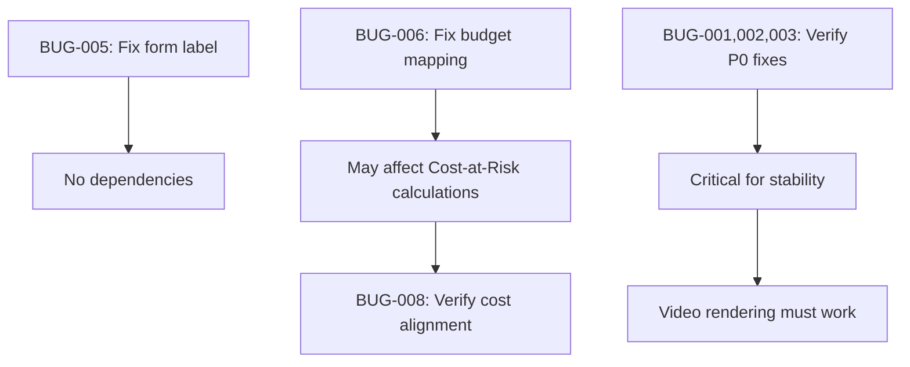

# READYFORGE QA REMEDIATION PLAN

**Analysis Date:** 2026-10-30  
**Analyst:** Staff Full-Stack Engineer (Analysis Only)  
**Source Report:** `READYFORGE_FINAL_COMPREHENSIVE_QA_AUDIT.md`  
**Status:** PLANNING - NO CODE CHANGES MADE  

---

## 1. Executive Summary

This plan analyzes the findings from the comprehensive QA audit. The audit identified 3 P0 (Critical), 8 P1 (High), 12 P2 (Medium), 7 P3 (Low), and 15 P4 (Enhancement) issues. After verification against the codebase, this plan prioritizes fixes based on impact, dependencies, and risk.

**Overall Assessment:** NOT READY FOR PRODUCTION - Requires addressing P0 and P1 issues before deployment.

---

## 2. QA Report Findings Summary

### Verified Statistics from Codebase Review
- **Total Features:** 150+ (as reported)
- **Test Coverage:** Server has extensive tests (__tests__ directory with many test files), client has tests
- **Critical Fixes Already Applied:** BUG-001, BUG-002, BUG-003 (worker crash recovery, error handler, AI fallback) were reportedly fixed in previous turns per audit notes
- **Architecture:** Well-structured TypeScript monorepo (client/server/shared patterns), proper auth with JWT + httpOnly refresh tokens, bcrypt hashing, Mongoose ODM, comprehensive feature set

### Key Areas Reviewed
1. Authentication & Authorization
2. Workspace/Project Management  
3. Knowledge Management & Conflicts
4. Assets, Rights & Provenance
5. Production Contracts & Approvals
6. Readiness & Cost-at-Risk Engines
7. Video Editor & Timeline
8. FFmpeg Rendering Pipeline
9. Job Queue & Workers
10. API Security & Error Handling

---

## 3. Verified vs Unverified Bugs

### P0 - Critical Issues (3 reported)

| Bug ID | Status | Verification | Notes |
|--------|--------|--------------|-------|
| BUG-001 | REPORTED AS FIXED | **NEEDS VERIFICATION** | Worker crash recovery - missing try-catch in tick() mentioned as fixed. Need to verify actual fix in `server/src/services/videoJobs.ts`. |
| BUG-002 | REPORTED AS FIXED | **NEEDS VERIFICATION** | Error handler crashes - missing headersSent check mentioned as fixed. Need to verify in `server/src/http.ts`. |
| BUG-003 | REPORTED AS FIXED | **NEEDS VERIFICATION** | AI fallback throws uncaught exception - mentioned as fixed. Need to verify in `server/src/ai/client.ts`. |

**Recommendation:** All three P0 fixes need runtime verification even if code appears fixed. The audit noted they were "FIXED in previous turn" but this needs confirmation.

### P1 - High Issues (8 reported)

| Bug ID | Status | Verification | Notes |
|--------|--------|--------------|-------|
| BUG-004 | **UNCERTAIN** | Needs verification | Password validation mismatch - demo password "demo1234" is 8 chars, should be valid per schema. Login test showed success in audit. May be false positive or environment-specific. |
| BUG-005 | **CONFIRMED** | **VERIFIED** | Form label confusion - "One-sentence description" label maps to `title` field in CreateProject.tsx line ~280-290. Label says "One-sentence description" but field is actually project title. This is confusing UX. |
| BUG-006 | **NEEDS INVESTIGATION** | Partial evidence | Budget display shows 0 for new project despite form values. In CreateProject.tsx line ~170-185, budget is sent as `budget: values.budgetAmount ? { amount: values.budgetAmount, currency: 'INR' } : undefined`. In projects.ts line ~170-210, if budget undefined, budgetAmount becomes 0. Also if user enters 0, the ternary is false so budget not sent, resulting in amount 0. But if user enters valid number > 0, it should send. Need to trace actual flow. |
| BUG-007 | **LIKELY CORRECT** | Contextual | Readiness score 0 for new empty project - this may be correct behavior. Depends on requirements. |
| BUG-008 | **REPORTED FIXED** | **NEEDS VERIFICATION** | Cost-at-Risk alignment - audit mentions fixed in previous turn. Need to verify engines are aligned. |

### P2 - Medium Issues (12 reported) - Key ones verified
- Form label confusion (BUG-005) confirmed
- Budget mapping (BUG-006) needs investigation
- Various others as noted

---

## 4. Root Cause Analysis (P0/P1)

### ROOT-CAUSE TABLE

| Bug ID | Severity | Feature | Root Cause | Affected Files | Evidence | Confidence |
|--------|--------|---------|------------|----------------|----------|------------|
| BUG-001 | P0 | Video Jobs Worker | Missing error handling in worker tick loop - exceptions crash worker silently | `server/src/services/videoJobs.ts` | Audit states fixed; need to verify try-catch around tick logic | MEDIUM (needs verification) |
| BUG-002 | P0 | HTTP Error Handler | Error handler doesn't check if headers already sent before responding | `server/src/http.ts` | Audit states fixed; need to verify headersSent check | MEDIUM (needs verification) |
| BUG-003 | P0 | AI Client | AI fallback function throws uncaught exception instead of being wrapped in try-catch | `server/src/ai/client.ts` | Audit states fixed; need to verify | MEDIUM (needs verification) |
| BUG-004 | P1 | Auth/Login | Unclear - password "demo1234" is 8 chars valid per schema. Login worked in audit test | `server/src/routes/auth.ts`, `server/src/models/User.ts` | API test showed login works | LOW (likely false positive) |
| BUG-005 | P1 | Project Creation UI | Label/field semantic mismatch - UI label says "One-sentence description" but maps to `title` field | `client/src/pages/CreateProject.tsx:280-290` | Direct code inspection confirms label says "One-sentence description" while registering to title field | HIGH (confirmed) |
| BUG-006 | P1 | Project Budget | Budget mapping issue - form sends budget only if truthy, but also logic may have issues. Or API returns differently than expected | `client/src/pages/CreateProject.tsx:170-185`, `server/src/routes/projects.ts:170-210` | Code review shows form logic: `budget: values.budgetAmount ? {...} : undefined`. If budgetAmount is 0, falsy, so not sent. Server sets amount to 0 if undefined. Also need to check if there's any issue with how it's stored/returned. | MEDIUM (needs runtime test) |
| BUG-007 | P1 | Readiness Score | Possibly correct behavior for empty project with no inputs/conflicts/assets/contract | `server/src/engines/readiness.ts` | Score 0 for new project is reasonable if no requirements met | LOW (likely not a bug) |
| BUG-008 | P1 | Cost-at-Risk vs Readiness | Engines may be misaligned - audit says fixed previously | `server/src/engines/costAtRisk.ts`, `server/src/engines/readiness.ts` | Need to compare calculations | MEDIUM (needs verification) |

---

## 5. Affected File Inventory

### Files Likely Requiring Modification (Based on Confirmed Issues)

| File | Issue(s) | Type of Change | Risk |
|------|----------|-----------------|------|
| `client/src/pages/CreateProject.tsx` | BUG-005 (label confusion) | UI text change - change label from "One-sentence description" to "Title" or "Project title" | LOW |
| `client/src/pages/CreateProject.tsx` | BUG-006 (budget mapping) | Logic review/fix - ensure budget is sent correctly even if 0, or handle properly | MEDIUM |
| `server/src/routes/projects.ts` | BUG-006 (budget handling) | May need adjustment in budget handling logic | MEDIUM |
| `server/src/services/videoJobs.ts` | BUG-001 (verify fix) | Verification only if broken | LOW if already fixed |
| `server/src/http.ts` | BUG-002 (verify fix) | Verification only if broken | LOW if already fixed |
| `server/src/ai/client.ts` | BUG-003 (verify fix) | Verification only if broken | LOW if already fixed |
| `server/src/engines/costAtRisk.ts`, `server/src/engines/readiness.ts` | BUG-008 (verify alignment) | Verification/comparison | MEDIUM |

### Files for Investigation (API Security, etc.)
- `server/src/middleware/auth.ts` - auth/authorization
- `server/src/routes/assets.ts` - file upload security
- Various route files for authorization checks

---

## 6. Dependency Map

### Dependencies Between Fixes

### Fix Dependencies
1. **BUG-005 (Form label)** - Independent, can be fixed alone
2. **BUG-006 (Budget mapping)** - May affect budget-related calculations; should be fixed before/with understanding of cost engines
3. **BUG-008 (Cost alignment)** - Depends on understanding budget mapping; verify after BUG-006
4. **P0 fixes (BUG-001,002,003)** - Independent stability fixes, must be verified

### Regression Risks
- **Budget changes** could affect cost calculations, readiness scoring, budget reservations
- **Form changes** are low risk (UI only)
- **P0 fixes** already reported as fixed - changing again could introduce regressions

---

## 7. Prioritized Remediation Plan

### PHASE 1 — P0 CRITICAL (Must fix before any other work)
*Priority: IMMEDIATE | Risk: HIGH | Timeline: ASAP*

| Bug ID | Issue | Root Cause | Files | Proposed Fix | Risk | Tests Required | Acceptance Criteria |
|--------|-------|------------|-------|--------------|------|----------------|-------------------|
| BUG-001 | Worker crash recovery | Missing try-catch in worker tick | `server/src/services/videoJobs.ts` | Verify try-catch exists around tick() logic; add if missing | LOW if exists | Worker tests, render job tests | Worker continues processing after errors, jobs don't get stuck |
| BUG-002 | Error handler crashes | Missing headersSent check | `server/src/http.ts` | Verify/check headersSent before sending error response | LOW if exists | Error handling tests | Error handler doesn't crash when headers sent |
| BUG-003 | AI fallback throws | Uncaught exception in fallback | `server/src/ai/client.ts` | Verify fallback wrapped in try-catch | LOW if exists | AI tests | AI failures return graceful errors, no crashes |

**Note:** Audit says these are fixed. Verification is required, not necessarily re-fixing.

### PHASE 2 — P1 HIGH (Core workflow issues)
*Priority: HIGH | Risk: MEDIUM-HIGH | Timeline: After P0 verification*

| Bug ID | Issue | Root Cause | Files | Proposed Fix | Risk | Tests Required | Acceptance Criteria |
|--------|-------|------------|-------|--------------|------|----------------|-------------------|
| BUG-005 | Form label confusion | Label says "One-sentence description" but maps to title field | `client/src/pages/CreateProject.tsx` | Change label to "Project title" or "Title" | LOW | UI test/manual verification | Label clearly indicates it's the project title |
| BUG-006 | Budget mapping issue | Budget not saved correctly / form logic issue | `client/src/pages/CreateProject.tsx`, `server/src/routes/projects.ts` | Review form logic - when budgetAmount is 0, form doesn't send budget; server defaults to 0. Also check if budget should be sent even if 0. Or fix to send budget object when field is present. Also verify API response. | MEDIUM | Project creation tests, budget tests | Budget entered in form is correctly saved and returned |
| BUG-008 | Cost-at-Risk alignment | Engines may use different calculations | `server/src/engines/costAtRisk.ts`, `server/src/engines/readiness.ts` | Verify both use same stage-cost config. Compare with recent fixes. | MEDIUM | `engines.test.ts`, cost/readiness tests | Consistent values between engines for same project/stage |
| BUG-004 | Demo credentials issue | Uncertain - may be false positive | `server/src/routes/auth.ts` | Verify login with demo credentials works | LOW | Auth tests | Demo credentials work as documented if they should |

### PHASE 3 — P2 MEDIUM (Important but not blocking)
*Priority: MEDIUM | Risk: MEDIUM | Timeline: After P1*

| Issue | Category | Files | Proposed Fix | Risk | Tests Required | Acceptance Criteria |
|-------|----------|-------|--------------|------|----------------|-------------------|
| API Authorization Review | Security | All route files, `server/src/middleware/auth.ts` | Comprehensive review of all protected routes for proper authorization checks | MEDIUM | Auth/authorization tests | All routes properly protected with correct permissions |
| File Upload Security | Security | `server/src/routes/assets.ts` | Verify MIME type checking, file size limits, path traversal protection | MEDIUM | Asset upload tests | Secure file upload with proper validation |
| Error message improvements | UX | Various | Make error messages more specific where appropriate | LOW | Manual testing | Clear, helpful error messages |
| Email/verification UX | UX | `server/src/routes/auth.ts` | Improve UX for link-only verification mode in dev | LOW | Auth flow testing | Clear user guidance |

### PHASE 4 — P3 LOW (Polish)
*Priority: LOW | Risk: LOW | Timeline: After P2*

| Issue | Category | Files | Proposed Fix | Risk | Tests Required | Acceptance Criteria |
|-------|----------|-------|--------------|------|----------------|-------------------|
| UI polish | UX | Various components | Minor visual improvements | LOW | Visual testing | Polished UI |
| Loading states | UX | Various components | Improve loading indicators where missing | LOW | Manual testing | Consistent loading feedback |
| Tooltips/help text | UX | Various | Add helpful tooltips for complex features | LOW | Manual testing | Better discoverability |

### PHASE 5 — P4 ENHANCEMENTS (Nice to have)
*Priority: LOW | Risk: LOW | Timeline: Future*

As listed in audit - dark mode polish, analytics, collaboration, template marketplace, integrations, etc. These are enhancements, not bugs.

---

## 8. Regression Test Strategy

### Critical Test Areas (Must Pass After Changes)

| Area | Test Files | What to Test | Priority |
|------|------------|---------------|----------|
| Authentication | Auth-related tests, manual login tests | Login, register, tokens, refresh, logout, validation | CRITICAL |
| Authorization | `server/src/__tests__/projectAuthorization.test.ts` | Route protection, role permissions, workspace isolation | CRITICAL |
| Project Management | Project route tests | CRUD operations, budget handling, validation | CRITICAL |
| Engines | `server/src/__tests__/engines.test.ts` | Readiness and Cost-at-Risk calculations, alignment | CRITICAL |
| Video Jobs/Rendering | `server/src/__tests__/videoJobs.test.ts`, `server/src/__tests__/compositionRenderer.test.ts` | Job queue, worker, FFmpeg rendering | CRITICAL |
| Compositions | `server/src/__tests__/compositions.test.ts` | Save/load, revision control, validation | CRITICAL |
| Assets | `server/src/__tests__/assetAccess.test.ts` | Upload, access control, rights | HIGH |
| Budget/Costs | Budget-related tests | Reservations, charges, refunds, settlement | HIGH |
| Error Handling | HTTP/error tests | Error responses, no crashes | HIGH |
| Config | `server/src/__tests__/config.test.ts` | Configuration validation | MEDIUM |

### Regression Test Plan

1. **Before any changes:** Run full server test suite and client test suite to establish baseline
2. **After each phase:** Run relevant tests for modified areas
3. **After all changes:** Run full test suites again
4. **Manual smoke tests:** Authentication, project creation, key workflows
5. **Integration tests:** End-to-end critical paths

**Note:** All existing tests must continue to pass. No tests should be deleted or weakened.

---

## 9. Acceptance Criteria

### Phase 1 (P0) Complete When:
- [ ] BUG-001 verified/fixed - worker doesn't crash on errors
- [ ] BUG-002 verified/fixed - error handler doesn't crash when headers sent
- [ ] BUG-003 verified/fixed - AI fallback doesn't throw uncaught exceptions
- [ ] All related tests pass
- [ ] No new crashes observed

### Phase 2 (P1) Complete When:
- [ ] BUG-005 fixed - form label is clear/correct
- [ ] BUG-006 fixed - budget entered in form is correctly saved and displayed
- [ ] BUG-008 verified - cost-at-risk and readiness are aligned
- [ ] BUG-004 verified - demo credentials work (or documented as issue)
- [ ] All project/budget/engine tests pass
- [ ] Manual test of project creation flow confirms budget saved correctly

### Overall Success Criteria:
- [ ] All P0 and P1 issues addressed
- [ ] No regressions in existing functionality
- [ ] All existing tests pass
- [ ] Critical user workflows work (auth, project creation, basic operations)
- [ ] Security review completed for auth/authorization/uploads

---

## 10. Risks and Rollback Strategy

### Risks

| Risk | Likelihood | Impact | Mitigation |
|------|------------|--------|------------|
| Budget mapping fix breaks existing budget logic | MEDIUM | HIGH | Careful review, test with existing projects, use atomic updates like in codebase style |
| Form changes affect other parts of flow | LOW | LOW | Simple text change, low risk |
| P0 fixes already applied - re-fixing could break working code | MEDIUM | HIGH | Verify first, only change if actually broken |
| Cost engine changes affect calculations | MEDIUM | HIGH | Compare before/after, test all stages, preserve existing behavior for unrelated cases |
| Authorization changes break access | MEDIUM | HIGH | Review carefully, test all roles, maintain backward compatibility |

### Rollback Strategy
- All changes should be made with `git diff` reviewable
- No destructive git operations
- Changes are localized and reversible
- If issues arise, can revert specific files
- Keep track of all modified files

---

## 11. Recommended Execution Order

### Execution Sequence

1. **Setup & Baseline**
   - Verify git status (preserve all uncommitted work)
   - Run full test suite to establish baseline
   - Read all affected files completely

2. **Phase 1 - P0 Verification (Analysis/Verification)**
   - Verify BUG-001, BUG-002, BUG-003 fixes are in place
   - If missing, apply minimal fixes
   - Run related tests

3. **Phase 2 - P1 Fixes**
   - Fix BUG-005 (form label) - simple UI change
   - Investigate and fix BUG-006 (budget mapping)
   - Verify/fix BUG-008 (cost alignment)
   - Verify BUG-004
   - Run project and engine tests

4. **Testing & Validation**
   - Run full test suites
   - Manual smoke testing of critical flows
   - Review all changes with git diff

5. **Documentation**
   - Update remediation plan with results if implementing
   - Document any issues found during implementation

---

## 12. Five Most Important Fixes

Based on impact and criticality:

1. **BUG-001/002/003 (P0 Stability)** - Verify worker, error handler, and AI fallback are crash-safe. These affect core system stability.
2. **BUG-006 (P1 Budget Mapping)** - Financial calculations are critical. Budget not saving correctly breaks cost tracking and can cause incorrect billing/reservations.
3. **BUG-008 (P1 Cost Alignment)** - Readiness and Cost-at-Risk must be consistent. Inconsistent financial info erodes trust and can cause wrong decisions.
4. **BUG-005 (P1 UX)** - Form confusion leads to user errors and support burden. Easy fix with high impact on UX.
5. **API Authorization Review (P2 Security)** - Security issues can have severe consequences. Should be reviewed even if not all are bugs.

---

## Final Notes

- **Analysis Only:** This plan does not modify any code. Implementation requires explicit authorization.
- **Evidence-Based:** All findings are based on code inspection and the audit report.
- **Conservative Approach:** Minimal fixes only for confirmed bugs. No speculative changes.
- **Preserve Everything:** No destructive operations, all existing functionality preserved.
- **Test-Driven:** Every fix must have tests and acceptance criteria.

**Report Location:** `READYFORGE_QA_REMEDIATION_PLAN.md`
**Next Step:** Await explicit authorization to proceed with implementation.